# 振幅估计

本库提供标准振幅估计、迭代振幅估计、最大似然振幅估计和快速振幅估计。四者共享
`AmplitudeEstimationProblem`，由调用方显式提供：

- 固定、完全绑定且静态酉的状态制备线路 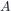；
- 与  同宽的固定、完全绑定且静态酉 Grover 迭代线路 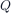；
- 非空且无重复的目标量子比特位置；
- 将目标寄存器测量字符串判为好态或坏态的谓词。

线路按量子比特插入位置映射到连续位置 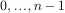。Sampler 返回的字符串右端
对应 `objective_qubits` 的第一项，谓词直接接收这一字符串。组件验证线路机械约束，
但不通过指数规模分析证明调用方给出的 、 和好态谓词在数学上相互一致。

若

<p align="center">
  
</p>

则相关二维子空间上的  本征相位为 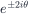，并且
 的好态概率为 。

## 标准振幅估计

`StandardAmplitudeEstimation` 复用通用 `PhaseEstimationCircuit`，使用 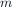 个估计
量子比特、完整逆 QFT，以及受控 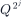。因此标准振幅估计与 QPE 共享同一套
全局相位、量子比特位序和内存限制处理。当前 Core 没有将任意线路提升为量子受控
线路的通用接口，因此底层使用完整稠密矩阵：

<p align="center">
  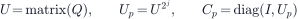
</p>

`Circuit.to_matrix` 的顺序从最低有效位到最高有效位，而数值酉门追加列表的第一项是
门局部矩阵的最高有效张量因子。因此  必须追加到
`[control, *reversed(system_targets)]`。实现保留  的全局相位，并在分配前执行
固定内存上限检查。该路径的矩阵存储和计算均为指数规模；生成的数值酉门也不保证
每个远端后端都能接受或分解。

测得估计寄存器整数 `y` 后，先归入规范振幅网格
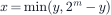。有限 shots 下会把同一振幅的两个相位代表的频数相加，再选频数
最大的规范网格；规范网格并列时选择最小 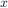。返回值为

<p align="center">
  
</p>

`grid_point` 就是上述规范网格 ，其范围为 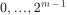；
`evaluation_probabilities` 仍保存全部 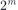 个原始相位经验概率，包括零概率网格点。
有限 shots 结果不额外声明严格置信区间。
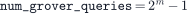 表示线路中的 Grover 幂次数总和，
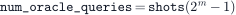 表示按 shots 加权的查询数。

## 迭代振幅估计

`IterativeAmplitudeEstimation` 每轮采样普通线路 ，使用
Chernoff--Hoeffding 区间约束 ，再按同半圆规则选择下一轮幂次。
论文 Algorithm 1 的理论轮数界

<p align="center">
  
</p>

用于置信预算；同一幂次 `k` 再次出现时，把它的好态数和 shots 与此前数据合并，再用

<p align="center">
  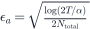
</p>

更新区间。为遵守 no-overshooting 规则，先从基准 `shots=N_shots` 计算

<p align="center">
  
</p>

当 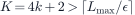 时，该轮实际 shots 降为
；`round_shots` 与按 shots 加权的查询数均记录
实际值。binary64 实现要求
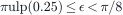：除以 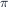 后的规范角度目标至少覆盖
`[0,0.25]` 上最坏的相邻浮点间距。`max_rounds` 至少为 `T`，并且基准 shots 必须使
`Lmax` 的实数构造成立。基准 `shots` 还必须不超过 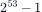，以保证参与
binary64 Chernoff--Hoeffding 几何计算的整数频数可精确表示，并避免超大 Python
整数隐式转换造成非契约异常。

幂次选择中的 `Kmax`、整数圈编号和上下半圆包含关系均以
`Fraction.from_float` 表示调用时的实际 binary64 区间端点，再做精确有理比较；不以
固定浮点容差把跨越半圆边界的区间视为合法。同样，区间更新的圈编号也由旧下界的
精确有理表示计算。

同一轮所有尚未收敛的问题合并为一次 Sampler 批调用；下一轮依赖当前观测，所以
不能把全部轮次预先合并。

角度区间宽度不超过  且实际 binary64 振幅区间宽度不超过
 后才停止；构造结果前还会直接复核后一个条件。
`T` 是置信预算所覆盖的同幂次数据组数界，相同 `k` 的多轮采样合并为一组；
`max_rounds` 则是实际 Sampler 迭代次数的独立硬上限，不参与置信预算。因此
 只是合法性条件，不保证给定观测一定能在该上限内收敛。达到上限
仍未收敛时抛出 `RuntimeError`，不会把未收敛结果伪装成成功。结果保留逐轮幂次、
实际 shots 和振幅区间。

## 最大似然振幅估计

`MaximumLikelihoodAmplitudeEstimation` 对固定、严格递增且从 `0` 开始的幂次序列，
一次批量执行全部  线路。若第  个实验观察到  次好态、总 shots 为
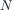，则在  最大化

<p align="center">
  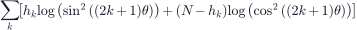
</p>

公共请求要求 。Core 的结果对象在 64 位主机上以 Rust `usize`
承载 shots，表示范围更大；这里采用更严格的算法边界，是因为候选生成的一阶导数
几何仍使用 binary64，只有不超过该上限的整数频数才能保证精确表示。超限请求会在
调用 Sampler 前失败。内部高精度数学搜索可独立验证更大计数，但不扩大公共执行契约。

似然通常多峰。实现用所有正弦和余弦奇点划分完整物理区间；对数似然在每个所得开
区间内严格凹，因此其一阶导数单调递减。每个区间通过稳定 score 的符号二分定位唯一
内部根；若无根则由单边导数极限选择合法端点。边界以 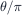 的有理数表示，从
代数上识别概率恰为 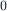 或 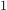 的项；开区间内部直接累计稳定的
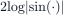 和 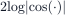，不以宽松裁剪替代零概率语义。
只有 score 根的最终包围区间能证明它距离某个精确边界不超过 `search_precision` 时，
才把结果吸附到该边界；不会因为巨大总对数似然在浮点中形成平台而统一偏向边界。
跨区间的全域候选改用标准库 `Decimal` 重新评分：内部候选从其 binary64 `theta` 的
所在的精确 Fraction 奇点区间开始，用 Decimal score 独立细化根，而不是直接评分
用户精度下的 binary64 中点；随后按高精度  做模约化，并用高精度 Taylor 正弦、
余弦与 Decimal 对数计算似然。整个过程不会先计算双精度三角函数再转换。精确有理
边界继续代数处理概率 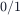。工作精度至少覆盖 shots 与最大频率的十进制位数并保留
guard digits，而且用两档精度复算候选排序；若排序改变，再提高一档，仍不稳定则显式
报错。全域比较不使用按似然绝对值或 shots 放大的相对容差。公开
`log_likelihood` 仍是选中候选对应的有限 float。低于
 浮点分辨率的 `search_precision` 会在执行前被拒绝，搜索还包含有限迭代
与浮点停滞保护。`asymptotic_interval` 是
根据 Fisher 信息构造并映射回振幅的 95% 渐近区间，同时作为共享
`confidence_interval` 字段返回；它不是有限样本覆盖保证。

## 快速振幅估计

`FasterAmplitudeEstimation` 实现 Nakaji 的两阶段快速振幅估计，不使用相位寄存器、
受控 Grover 幂或逆 QFT。每轮执行普通线路 ；第一阶段用一个余弦估计逐轮
缩小  区间，达到相位消歧条件后，第二阶段用两个不同 Grover 幂的余弦估计
恢复正弦和余弦，从而继续倍增查询深度。同一轮所有请求合并为一次 Sampler 批调用，
后续轮次仍依赖当前观测。

算法要求实际送入的估计问题已经满足 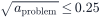。请求中的
`amplitude_rescaling_factor` 只声明调用方已经施加的幅度缩放，不会改写线路：

- `1.0` 表示直接估计这个小振幅问题；
- `0.25` 表示调用方已经构造了配套的缩放后 、 和好态谓词，返回值再除以
  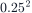 恢复原目标。

经典 `is_good_state` 谓词不足以自动生成量子 Oracle，复用未缩放问题的旧 Grover
迭代线路也不能代表缩放后的问题。因此实现不会在内部静默执行自动缩放。

总失败概率预算 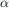 在至多  次余弦估计之间均分。单次预算为
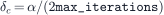，第一、第二阶段每条线路的 shots 分别为

<p align="center">
  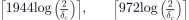
</p>

结果中的 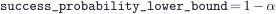 是联合界给出的理论下界，不是从
本次样本估计出的经验成功概率。`powers`、`circuit_shots`、`good_counts` 和逐轮
`theta_intervals` 记录完整执行轨迹。查询统计沿用本库口径：
`num_grover_queries` 是所有线路中 Grover 指数之和，`num_oracle_queries` 是按每条
线路 shots 加权后的指数之和。因为当前线路构造显式重复 ，请求会在构造前拒绝
单条线路超过一百万次 Grover 重复的规模。

## 示例

```python
import math

from cqlib import Circuit
from cqlib_algorithms import (
    AmplitudeEstimationProblem,
    MaximumLikelihoodAmplitudeEstimation,
    MaximumLikelihoodAmplitudeEstimationRequest,
)
from cqlib_algorithms.operators import StatevectorSampler

theta = math.pi / 8
preparation = Circuit(1)
preparation.ry(0, 2 * theta)
grover = Circuit(1)
grover.ry(0, 4 * theta)
problem = AmplitudeEstimationProblem(
    preparation,
    grover,
    (0,),
    lambda bits: bits == "1",
)

algorithm = MaximumLikelihoodAmplitudeEstimation(StatevectorSampler())
result = algorithm.run(
    [MaximumLikelihoodAmplitudeEstimationRequest(problem, (0, 1, 2, 4), 1000)]
)[0]
print(result.estimation, result.asymptotic_interval)
```

快速振幅估计必须使用满足小振幅承诺的问题。例如：

```python
from cqlib_algorithms import (
    FasterAmplitudeEstimation,
    FasterAmplitudeEstimationRequest,
)

theta = 0.1
preparation = Circuit(1)
preparation.ry(0, 2 * theta)
grover = Circuit(1)
grover.ry(0, 4 * theta)
problem = AmplitudeEstimationProblem(
    preparation,
    grover,
    (0,),
    lambda bits: bits == "1",
)

algorithm = FasterAmplitudeEstimation(StatevectorSampler())
result = algorithm.run(
    [FasterAmplitudeEstimationRequest(problem, alpha=0.05, max_iterations=5)]
)[0]
print(result.estimation, result.confidence_interval)
```

若目标振幅大于 `0.25`，调用方应先构造数学上一致的缩放后问题，并在请求中设置
`amplitude_rescaling_factor=0.25`；不能只修改该参数而继续传入原来的  和 。

## 理论来源

- G. Brassard, P. Høyer, M. Mosca, A. Tapp，*Quantum Amplitude
  Amplification and Estimation*，arXiv:quant-ph/0005055，Algorithm `Est_Amp`
  与 Theorem 12。
- D. Grinko, J. Gacon, C. Zoufal, S. Woerner，*Iterative Quantum Amplitude
  Estimation*，arXiv:1912.05559v3，Algorithms 1–2 与 Theorem 1。
- Y. Suzuki 等，*Amplitude Estimation without Phase Estimation*，
  arXiv:1904.10246v2，Eqs. (4)–(13)。
- K. Nakaji，*Faster Amplitude Estimation*，Quantum Information &
  Computation 20(13&14), 1109–1123, 2020，arXiv:2003.02417，Algorithm 1。

