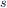

# Bernstein-Vazirani 算法

`BernsteinVazirani` 是一个完整的独立算法组件，用一次 Oracle 查询恢复线性布尔
函数的隐藏字符串。

## 数学定义

给定承诺为线性的函数 （隐藏字符串 ），算法线路为

<p align="center">
  
</p>

即一次相位 Oracle 查询夹在两层 Hadamard 之间，末态恰好是隐藏字符串对应的计算
基态。理想执行下全寄存器测量以概率 1 得到 ，单次查询即恢复；经典确定算法
需要  次函数求值。

理论依据为 Bernstein 与 Vazirani 的原始工作：
[Quantum complexity theory](https://doi.org/10.1137/S0097539796300921)，
SIAM J. Comput. 26(5), 1411 (1997)；相位 Oracle 形式的推导参见 Cleve 等人的
[Quantum Algorithms Revisited](https://arxiv.org/abs/quant-ph/9708016)。

## 组件组合

`BernsteinVazirani(sampler)` 构造时注入任意显式继承 `Sampler` 的组件，不绑定
本地模拟器或具体平台：

- 查询线路由 `HadamardPhaseQuery` 组合两层 Hadamard 与 `PhaseOracle`；函数校验
  （类型、`output_mask` 规则）最终委托该底层 Oracle。多输出函数按
  `output_mask` 奇偶归约为标量谓词，线性承诺作用于该奇偶函数；
- `BernsteinVazirani.build_circuit(function, output_mask=None)` 构建未测量的
   查询线路（与 `DeutschJozsa` 共享同一查询线路构造），
  末端测量由 Sampler 追加；
- `run(requests)` 批量执行请求，结果按请求顺序返回。

`BernsteinVaziraniRequest(function, shots, output_mask=None)` 中 `shots` 必须为正整数。
`BernsteinVaziraniResult(modal_strings, support, shots)` 保留所有并列的经验众数候选；
每个候选的第 `q` 位对应量子比特 `q`
（小端，采样位串最右字符是 `q0`）。唯一众数时 `hidden_string` 返回该候选，
`hidden_integer` 返回等价整数（第 `q` 位权重 ）；发生平局时两者均为
`None`，调用方可从 `modal_strings` 查看全部候选。`support` 是每个众数候选的
观测 shots 数。

## 判别语义与边界

- 结果**只来自测量统计**：组件保留全部观测频数最高的位串。理想承诺执行下只有
  一个候选且 `support == shots`；带噪声后端可能产生唯一经验众数或多个并列众数，
  组件不假定噪声模型，不把经验众数表述为纠错、最大似然或置信度结论；
- 算法从不读取真值表做线性承诺校验（显式真值表的 Oracle 综合本身必须读表，
  但承诺是否成立不由算法检查）。输入违反线性承诺时，结果仍按众数规则形式
  计算，但语义未定义；
- 采样结果契约与库内其他采样算法一致：要求成功的终态结果、shots 与量子比特
  顺序匹配、频数总数等于请求 shots；过滤或后选择的不完整频数会被拒绝；
- 每条构建的线路含一次相位 Oracle 应用；多次 shots 是重复执行同一线路实验，
  不能表述为一次总的物理 Oracle 求值。组件不选择后端、不管理迭代、不做误差
  缓解。

## 可运行示例

```python
from cqlib_algorithms import BernsteinVazirani, BernsteinVaziraniRequest
from cqlib_algorithms.operators.oracle import BooleanFunction
from cqlib_algorithms.operators.sampler import StatevectorSampler

# 隐藏字符串 s = 0b101：f(x) = x0 XOR x2
hidden = 0b101
function = BooleanFunction.from_truth_table(
    [(x & hidden).bit_count() % 2 == 1 for x in range(8)]
)

result = BernsteinVazirani(StatevectorSampler()).run(
    [BernsteinVaziraniRequest(function, 16)]
)[0]
print(result.hidden_string)  # (True, False, True)
print(result.hidden_integer)  # 5
print(result.modal_strings)  # ((True, False, True),)
print(result.support)  # 16
```
