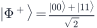

# CHSH 不等式验证

`CHSH` 通过公共 `Estimator` 契约计算四个二体相关函数，并据此评估
Clauser–Horne–Shimony–Holt（CHSH）见证量。组件默认制备 Bell 态

<p align="center">
  
</p>

也接受调用方提供的固定二量子比特状态制备组件。它负责构造可观测量、批量执行期望值
估计和解释数值结果，不绑定模拟器或硬件后端。

## 数学定义

Alice 对应线路插入顺序中的量子比特位置 0，Bob 对应位置 1。双方各有两个位于
X–Z 平面的二值可观测量：

<p align="center">
  
</p>

若 Alice 的角度为 `(a0, a1)`，Bob 的角度为 `(b0, b1)`，则算法计算

<p align="center">
  
</p>

局域隐变量模型满足 。理想量子理论满足 Cirel'son 上界
。默认设置为

<p align="center">
  
</p>

对默认  态给出 。定义与界限分别依据 CHSH 原始论文
[Phys. Rev. Lett. 23, 880 (1969)](https://doi.org/10.1103/PhysRevLett.23.880)
及 Cirel'son 的量子相关界限
[Lett. Math. Phys. 4, 93–100 (1980)](https://doi.org/10.1007/BF00417500)。

## 接口

```python
from cqlib_algorithms import CHSH
from cqlib_algorithms.operators import GHZStatePreparation, StatevectorEstimator

algorithm = CHSH(StatevectorEstimator())
result = algorithm.run(GHZStatePreparation(2))
print(result.chsh_value)  # approximately 2.82842712
print(result.violates_classical_bound)  # True
```

精确估计的典型输出为：

```text
(0.7071067811865476, 0.7071067811865476,
 0.7071067811865476, -0.7071067811865476)
2.82842712474619
True
```

`run(state_preparation=None, *, alice_angles=None, bob_angles=None, shots=None, tolerance=None)`
返回一个 `CHSHResult`。省略初态时制备 Bell 态，省略角度时使用上述设置，数值容差默认为 `1e-12`。
可将示例中的制备组件替换为 `BasisStateInitialization(2, 0)`，比较乘积态与纠缠态的关联量。
组件使用前缀 `chsh` 构建，生成的线路必须完全绑定且宽度为 2。

批量入口 `run(requests)` 接收 `CHSHRequest`。其参数如下：

- `state_preparation`：可选的固定二量子比特 `StatePreparation` 组件。省略时复用
  `GHZStatePreparation(2)` 制备 ；
- `alice_angles`、`bob_angles`：各自恰含两个有限实数的元组；
- `shots`：`None` 表示请求精确估计，正整数表示把有限-shot 语义传给 Estimator；
- `tolerance`：判断  时使用的非负有限数值容差。

批次中的每项请求都可以直接配置状态制备组件：

```python
from cqlib_algorithms import CHSH, CHSHRequest
from cqlib_algorithms.operators import (
    BasisStateInitialization,
    GHZStatePreparation,
    StatevectorEstimator,
)

requests = [
    CHSHRequest(GHZStatePreparation(2)),
    CHSHRequest(BasisStateInitialization(2, 0)),
]
results = CHSH(StatevectorEstimator()).run(requests)
print([item.chsh_value for item in results])  # approximately [2.82842712, 1.41421356]
```

组件在请求构造时只构建一次，请求保存固定的 `StatePreparation` 和独立的
`preparation_circuit` 快照。快照在请求存续期间应保持不变，执行前会重新校验。
自定义制备线路通过 `UserCircuitPreparation(circuit)` 包装后传入。

自定义制备线路必须恰有两个量子比特、通过 Core 线路校验、不含未绑定符号，并且是
可展开的固定静态酉线路；直接或嵌套的测量、重置、延迟和经典控制都会在请求构造时
以及执行前的重新校验中被拒绝。算法按 `Circuit.qubits` 的插入位置解释 Alice 和
Bob，即使底层量子比特编号不连续或顺序重排。输入线路不会被修改，执行使用规范化
后的独立副本。

## 结果语义

`CHSHResult.correlators` 固定按 `(E00, E01, E10, E11)` 排列，并提供同名属性：

- `chsh_value`：有符号的 ；
- `absolute_value`：；
- `violation_margin`：，没有截断，未违反时为负；
- `violates_classical_bound`：是否满足 ；
- `classical_bound`：经典界 ；
- `tsirelson_bound`：理想量子界 ；
- `variances`：四个 Estimator 返回的估计量方差；
- `standard_deviation_upper_bound`：全部方差已知时的
  ，否则为 `None`。

最后一项是在不知道协方差时通过三角不等式得到的保守标准差上界，不是置信区间或
显著性检验。`tolerance` 同样只处理浮点比较，不表达统计置信度。

算法不会拒绝超出  的经验相关值，也不会把超出  的有限-shot
或误差缓解结果自动裁剪。这样可以如实保留 Estimator 输出；调用方必须结合后端、
采样方差和实验模型解释异常值。

## 执行与组合

每个请求展开为四个 `EstimatorRequest`，其顺序为 `E00, E01, E10, E11`。若输入
包含 `N` 个请求，算法先完成全部请求、线路和可观测量校验，再用一次 Estimator
调用提交 `4N` 个请求；空批次直接返回空列表且不会调用 Estimator。

每个乘积可观测量展开为 Alice/Bob 下标明确的 、、
、 有限 Hermitian Hamiltonian：

<p align="center">
  
</p>

Core 量子比特位置 0 是 Alice，位置 1 是 Bob；在 Core 的小端态矢量稠密矩阵顺序
中，上述乘积写为 。实现按量子比特位置设置 Pauli 轴而不
依赖字符串显示顺序，因此保持这一约定。绝对值不超过 `1e-15` 的数值零系数被省略。

## 边界

实现限定在 X–Z 平面的二设置 CHSH 见证量，不提供：

- 任意 Bloch 球三维测量轴或一般 Bell 不等式；
- 状态层析、误差缓解或后端校准；
- 统计显著性、假设检验或置信区间；
- 探测、定域、自由选择等实验漏洞分析；
- 未绑定参数线路或参数扫描管理。

因此，`violates_classical_bound=True` 只表示所给 Estimator 数值超过了带容差的经典
界，不应单独解释为无漏洞实验结论。
