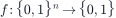
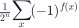
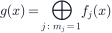
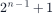

# Deutsch-Jozsa 算法

`DeutschJozsa` 是一个完整的独立算法组件。每条算法线路包含一次相位 Oracle
调用，用于在常函数/平衡函数承诺下进行判别。

## 数学定义

给定承诺为常函数或平衡函数的 ，算法线路为

<p align="center">
  
</p>

最终态在全零计算基态上的振幅为

<p align="center">
  
</p>

常函数时模为 ，平衡函数时恰为 。在满足承诺的理想无噪声执行中，
一次 shot 已足够确定性判别：全零结果表示"常"，任意非全零结果表示"平衡"。
组件对任意注入的 Sampler 都使用相同的观测规则，即仅当 `zero_count == shots`
时返回"常"，否则返回"平衡"；存在噪声时，该值只是观测判决，不构成无误差证明。

"一次查询"是指一条算法线路只包含一次相位 Oracle 调用。请求多个 shots 表示
重复该线路执行实验，不能把整个多-shot 采样任务描述为总共只进行了一次物理
Oracle 求值。

问题与算法的理论依据包括 Deutsch 与 Jozsa 的原始工作，以及对确定性量子算法
表述作出澄清和改进的后续工作：
[Rapid solution of problems by quantum computation](https://doi.org/10.1098/rspa.1992.0167)，
Proc. R. Soc. Lond. A 439, 553 (1992)；
[Quantum Algorithms Revisited](https://doi.org/10.1098/rspa.1998.0164)，
Proc. R. Soc. Lond. A 454, 339 (1998)。

## 组件组合

`DeutschJozsa(sampler)` 构造时注入任意显式继承 `Sampler` 的组件，不绑定本地
模拟器或具体平台：

- 查询线路由 `HadamardPhaseQuery` 组合两层 Hadamard 与 `PhaseOracle`；函数校验
  （类型、`output_mask` 规则）最终委托该底层 Oracle；输入变量数必须至少为 1；
- 多输出扩展定义派生标量函数
  ，其中  是 `output_mask`，
  常/平衡承诺作用于 ，而不是分别作用于每个输出位；
- `DeutschJozsa.build_circuit(function, output_mask=None)` 构建未测量的
   查询线路，末端测量由 Sampler 追加；
- `run(requests)` 批量执行请求，结果按请求顺序返回。

`DeutschJozsaRequest(function, shots, output_mask=None)` 中 `shots` 必须为正整数。
`DeutschJozsaResult(is_constant, zero_count, shots)`
记录判别与全零统计，`is_balanced` 为互补判定。

## 判别语义与边界

- 判别**只来自测量统计**：算法层不读取真值表来预先判断常/平衡承诺。输入函数
  违反承诺时，结果仍按振幅公式和观测规则形成，但判别在语义上未定义；
- 当前 `PhaseOracle` 接收显式有限真值表，线路综合必然读取该表并需要指数规模的
  经典输入和预处理。因此查询复杂度结论采用抽象 Oracle 模型，不表示本实现能以
  常数经典代价构造任意黑盒 Oracle；
- 采样结果契约与库内其他采样算法一致：要求成功的终态结果、shots 与量子比特
  顺序匹配、频数总数等于请求 shots；过滤或后选择的不完整频数会被拒绝；
- 组件不选择后端、不管理迭代、不做误差缓解；经典确定性最坏情形需要
   次抽象函数查询，而理想量子算法的一条线路使用一次抽象 Oracle
  查询。这是查询模型中的理论结论，不是对真值表综合或具体执行后端的性能承诺。

## 可运行示例

```python
from cqlib_algorithms import DeutschJozsa, DeutschJozsaRequest
from cqlib_algorithms.operators.oracle import BooleanFunction
from cqlib_algorithms.operators.sampler import StatevectorSampler

algorithm = DeutschJozsa(StatevectorSampler())

constant = BooleanFunction.from_truth_table([False] * 8)  # 常函数
balanced = BooleanFunction.from_truth_table(  # 奇偶函数：平衡
    [bin(x).count("1") % 2 == 1 for x in range(8)]
)

results = algorithm.run(
    [
        DeutschJozsaRequest(constant, 16),
        DeutschJozsaRequest(balanced, 16),
    ]
)
print([r.is_constant for r in results])  # [True, False]
print([r.zero_count for r in results])  # [16, 0]
```
