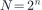
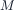
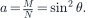
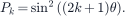
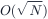

# Grover 搜索算法

`Grover` 在有限布尔函数的输入空间中放大被标记状态的测量概率。它是完整算法组件：
负责选择迭代次数、构造搜索线路、调用 `Sampler`，并从实际返回的 counts 计算搜索
成功率和最可能结果。

## 数学定义

设 ，其中  个输入满足布尔谓词。均匀初态中被标记子空间的初始
概率为

<p align="center">
  
</p>

相位 Oracle 对被标记状态施加负号，扩散反射随后把状态在好、坏两个子空间张成的
平面内旋转。重复  次后的总成功概率为

<p align="center">
  
</p>

请求没有显式指定 `iterations` 时，组件在首个连续最大值附近比较相邻非负整数，
选择成功概率最大且 Oracle 调用更少的整数。单解问题因而使用
 次抽象 Oracle 调用。理论依据见
[原始搜索算法](https://doi.org/10.1145/237814.237866)与
[振幅放大的一般化](https://doi.org/10.1090/conm/305/05215)。

## 接口与组件组合

`Grover(sampler)` 接收任意实现公共 `Sampler` 协议的执行组件。算法内部复用：

- `UniformSuperposition` 构造 ；
- `PhaseOracle` 根据标量函数或选定的向量输出奇偶值标记状态；
- `GroverOperator` 构造一次 Oracle 与扩散反射迭代；
- `Sampler` 对完整搜索寄存器进行有限-shot 测量。

`GroverRequest(function, shots, output_mask=None, iterations=None, seed=None)` 表示一次
搜索。`iterations` 为 `None` 时自动选择；非负整数则精确覆盖自动选择。向量函数必须
提供合法 `output_mask`，搜索谓词是所选输出位的异或值。

`GroverResult` 保存按计算基整数索引的完整 `counts`、标记状态、实际迭代次数和
shots，并提供：

- `success_count` 与 `success_probability`；
- `modal_states`：并列最高频状态，不擅自打破统计平局；
- `modal_bitstrings`：以量子比特编号递增的 little-endian 布尔元组；
- `marked_modal_states`：最高频结果中满足谓词的状态。

## 边界

- 零解问题会在执行前被拒绝，因为标准 Grover 搜索无法返回不存在的解；
- 全部状态均为解时自动选择零次迭代，均匀测量的每个结果都成功；
- 自动迭代公式属于标准均匀初态和完整扩散反射。更一般的初态或子空间反射应直接
  使用底层振幅放大组件，并按其初始成功振幅选择迭代次数；
- 结果判定完全来自 Sampler counts。有限 shots、噪声或不完整的硬件执行可能使
  最高频状态不是解，因此调用方应同时检查 `success_probability` 和
  `marked_modal_states`；
- 当前布尔函数以完整真值表表示，Oracle 综合具有指数级经典输入和预处理成本。
   是抽象黑盒查询复杂度，不包含该显式综合成本；
- 每条线路包含 `iterations` 次 Oracle 调用；多个 shots 会重复执行整条线路，不能
  把多-shot 任务描述为总共只调用这些次数。

## 示例

```python
from cqlib_algorithms import Grover, GroverRequest
from cqlib_algorithms.operators.oracle import BooleanFunction
from cqlib_algorithms.operators.sampler import StatevectorSampler

function = BooleanFunction.from_marked_states(3, [5])
algorithm = Grover(StatevectorSampler())
result = algorithm.run([GroverRequest(function, shots=1024, seed=7)])[0]

print(result.iterations)  # 2
print(result.modal_states)  # 通常为 (5,)
print(result.success_probability)  # 理想值约 0.945
```
