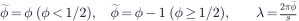

# 相位估计

本模块提供可复用相位估计电路、标准量子相位估计（QPE）、迭代量子相位估计
（IQPE）和 Hamiltonian 相位估计（HPE）。公共输入使用 Cqlib `Circuit`、
`Hamiltonian` 和本库 `Sampler`。

## 数学约定

对酉算子  的本征态 ，归一化本征相位定义为

<p align="center">
  
</p>

系统量子比特采用 Cqlib 小端序。 个估计量子比特的整数结果  表示
。所有状态制备和酉线路必须固定、完全绑定、静态且同宽；量子比特按
插入位置映射到连续位置。

## PhaseEstimationCircuit

`PhaseEstimationCircuit` 是无状态制备、无测量的 L2 复合线路算子。它依次执行：

1. 对估计寄存器施加 Hadamard；
2. 第  个估计量子比特控制 ；
3. 对估计寄存器施加逆 QFT。

当前 Core 尚无把任意线路直接提升为量子受控线路的通用接口，因此实现从
`Circuit.to_matrix` 构造 。该过程保留  的全局相位，但系统宽度的
内存复杂度为指数级；构造前执行 256 MiB 稠密工作集上限检查。数值酉门也不保证每个
远端后端都能直接接受或分解。

```python
component = PhaseEstimationCircuit(unitary, 4, approximation_degree=0)
circuit = component.build_circuit()
```

`approximation_degree` 直接传递给现有逆 `QFT`。估计位数限制为 52，确保公开的
binary64 相位结果仍具有逐位分辨能力，并避免超大指数转换产生非契约异常。

## 标准 QPE

`PhaseEstimationProblem(unitary, state_preparation)` 定义酉算子和输入态；
`PhaseEstimationRequest` 另外给出估计位数、shots 和可选 QFT 近似度。算法支持
输入态为本征态叠加：若

<p align="center">
  
</p>

则理想采样以  的权重观察对应本征相位。结果返回经验众数相位、整数网格点
和只包含已观测网格点的稀疏概率映射；众数并列时选择最小网格点。线路内逻辑酉调用
总数为 ，`num_unitary_queries` 是再乘 shots 的采样加权查询数。

```python
algorithm = PhaseEstimation(sampler)
result = algorithm.run(
    [PhaseEstimationRequest(problem, num_evaluation_qubits=4, shots=1024)]
)[0]
```

## 迭代 QPE

`IterativePhaseEstimation` 使用一个估计辅助比特，以独立线路从最低有效位向最高有效位
提取相位。第  轮使用受控 ，并根据已经得到的低位施加经典反馈相位；
每轮重新制备同一系统态。因不同位不在同一次相干演化中关联，该接口要求输入制备态
为一个本征态，不支持用一次运行解析本征态叠加的联合相位分布。

`shots_per_iteration` 控制每位的采样次数，按多数票确定该位，平票稳定选择 `0`。
结果按最高有效位到最低有效位返回 `bitstring` 和每位观测到 `1` 的概率。该实现用多个
静态线路和 Sampler 调用完成轮间反馈，不要求后端支持动态线路。

```python
algorithm = IterativePhaseEstimation(sampler)
result = algorithm.run(
    [IterativePhaseEstimationRequest(problem, num_iterations=4, shots_per_iteration=32)]
)[0]
```

## Hamiltonian 相位估计

对有限 Hermitian Pauli Hamiltonian `H`，HPE 选择正比例因子

<p align="center">
  
</p>

其中 `bound` 是本征值绝对值上界。若未显式提供，使用各 Pauli 项有效系数绝对值之和。
Core 的演化约定为 ，实现以  构造上述 。相位  先映射
到有符号区间，再恢复本征值：

<p align="center">
  
</p>

 与  都映射到相位端点 ，无法区分；可能占据端点时应提供严格
大于实际谱半径的 `bound`。对非对易 Pauli 项，Core 使用指定 `TrotterMode` 和
`trotter_steps` 合成演化，结果对应这一乘积公式近似；默认使用二阶公式、一步。
对易项由 Core 使用精确单遍分解。

```python
algorithm = HamiltonianPhaseEstimation(sampler)
result = algorithm.run(
    [
        HamiltonianPhaseEstimationRequest(
            hamiltonian,
            state_preparation,
            num_evaluation_qubits=5,
            shots=2048,
            bound=energy_bound,
            trotter_steps=4,
        )
    ]
)[0]
```

## 能力边界

- 标准 QPE 与 HPE 可返回本征态叠加产生的经验分布；IQPE 要求单一本征态承诺。
- 有限 shots 结果是经验估计，不附加置信区间或噪声缓解保证。
- 相位精度由估计位数、shots、QFT 近似度和后端误差共同决定。
- HPE 还包含 Hamiltonian 缩放界与非对易项演化近似误差。
- 稠密受控矩阵路径适合小系统验证，不表示多量子比特线路具有多项式经典构造成本。

## 理论与接口参考

- M. A. Nielsen、I. L. Chuang，*Quantum Computation and Quantum
  Information*，相位估计章节。
- A. Y. Kitaev，*Quantum measurements and the Abelian Stabilizer Problem*，
  arXiv:quant-ph/9511026。
