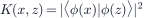

# 保真度量子核与 QSVR

`FidelityQuantumKernel` 通过量子特征线路计算样本相似度，核函数为
。`QSVR` 基于该核执行 ε-SVR 回归，提供训练、预测和 R² 评分。

QSVR 训练使用 scikit-learn，可通过 `cqlib-algorithms[machine-learning]` 安装经典计算依赖。

## 使用示例

以下示例使用 `RY(angle)` 特征线路拟合正弦函数数据。

```python
import numpy as np
from cqlib import Circuit, Parameter

from cqlib_algorithms.algorithms import QSVR
from cqlib_algorithms.operators import FidelityQuantumKernel

feature_map = Circuit(1)
feature_map.ry(0, Parameter("angle"))
kernel = FidelityQuantumKernel(feature_map, ["angle"])
X_train = np.linspace(-1.5, 1.5, 7).reshape(-1, 1)
y_train = np.sin(X_train[:, 0])
model = QSVR(kernel, C=10.0, epsilon=0.01).fit(X_train, y_train)
X_test = np.array([[-0.75], [0.25], [1.0]])
print("Predictions:", model.predict(X_test))
print("Training R2:", model.score(X_train, y_train))
```

## 量子核接口

```text
FidelityQuantumKernel(feature_map, input_parameters, *, parameter_bindings=None,
                      sampler=None, shots=None, max_statevector_qubits=20,
                      max_statevector_bytes=268_435_456)
evaluate(X, Y=None) -> numpy.ndarray
```

| 参数 | 含义 |
| --- | --- |
| `feature_map` | 参数化 Cqlib `Circuit`，绑定后要求静态酉且可逆 |
| `input_parameters` | 有序数据参数名，第 j 列输入绑定第 j 个参数 |
| `parameter_bindings` | 其余线路参数的固定数值 |
| `sampler`、`shots` | 同时提供时采用采样计算，`shots` 为每个样本对的采样次数；默认采用精确计算 |
| `max_statevector_qubits` | 精确计算的量子比特数上限，默认为 20 |
| `max_statevector_bytes` | 精确计算中保留态矢量幅度的存储预算，默认为 256 MiB |

输入参数名与固定参数名共同覆盖线路中的全部活跃符号，二者互斥。
`X`、`Y` 为有限实数二维数组，形状分别为 `(n,d)`、`(m,d)`，d 等于数据参数数量。

`evaluate(X)` 返回 `(n,n)` 的训练核矩阵，`evaluate(X,Y)` 返回 `(n,m)` 的交叉核矩阵。
相同输入的核值为 1。

## 回归接口

```text
QSVR(quantum_kernel, *, C=1.0, epsilon=0.1, tol=1e-3,
     max_iter=-1, enforce_psd=True)
fit(X, y, *, sample_weight=None) -> self
predict(X) -> numpy.ndarray
score(X, y, *, sample_weight=None) -> float
```

| 参数 | 含义 |
| --- | --- |
| `quantum_kernel` | `FidelityQuantumKernel` 实例 |
| `C` | 正的误差惩罚系数 |
| `epsilon` | ε 不敏感区间参数，取非负值 |
| `tol` | 求解器停止容差，取正值 |
| `max_iter` | 最大迭代次数，-1 表示由求解器决定停止 |
| `enforce_psd` | 是否在训练前对核矩阵进行半正定处理，默认为 `True` |

训练数据 `X` 为非空二维数组，`y` 为同样本数的一维有限实数向量。
可选 `sample_weight` 为正的样本权重。`predict` 返回一维预测数组，
`score` 返回 R²，评分数据至少包含两个样本。

## 模型结果

以下属性可在训练后读取：

| 属性 | 含义 |
| --- | --- |
| `support_` | 支持样本在训练数据中的索引 |
| `dual_coef_`、`intercept_` | 回归系数与截距 |
| `fit_status_`、`n_iter_` | 求解状态与迭代次数，状态 0 表示正常结束 |
| `raw_kernel_matrix_`、`kernel_matrix_` | 原始训练核矩阵与求解器使用的训练矩阵 |

## 采样模式

同时设置 Sampler 和 shots，即可使用采样核进行矩阵计算与回归。

```python
import math
from cqlib import Circuit, Parameter

from cqlib_algorithms.algorithms import QSVR
from cqlib_algorithms.operators import FidelityQuantumKernel
from cqlib_algorithms.operators.sampler import StatevectorSampler

feature_map = Circuit(1)
feature_map.ry(0, Parameter("angle"))
kernel = FidelityQuantumKernel(
    feature_map, ["angle"], sampler=StatevectorSampler(), shots=64
)
print("Kernel matrix:", kernel.evaluate([[0.0], [math.pi]]))
model = QSVR(kernel).fit([[0.0], [math.pi]], [0.0, 1.0])
print("Predictions:", model.predict([[0.0], [math.pi]]))
```

## 参考文献

- [Havlíček 等：Supervised learning with quantum-enhanced feature spaces](https://arxiv.org/abs/1804.11326v2)。
- [Smola、Schölkopf：A tutorial on support vector regression](https://alex.smola.org/papers/2004/SmoSch04.pdf)。
