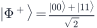

# 超密编码

`SuperdenseCoding` 实现 Bennett–Wiesner 超密编码协议的线路构造、批量采样与
经典解码统计。协议预共享一对 Bell 纠缠，Alice 只发送其中一个量子比特，Bob
便能恢复 Alice 选择的两个经典比特。

## 协议定义

线路位置固定为：

- 量子比特 0：Alice 持有并编码、随后发送给 Bob 的量子比特；
- 量子比特 1：Bob 预先持有的 Bell 对另一半。

算法复用 `GHZStatePreparation(2)` 制备

<p align="center">
  
</p>

公开消息采用 ，严格为两个 Python 整数位。
Alice 施加

<p align="center">
  
</p>

在算符乘积中右侧先作用，因此线路按 `Z`、`X` 的时间顺序追加：

| 消息 `(x,z)` | 编码操作 |
| --- | --- |
|  |  |
|  |  |
|  |  |
|  |  |

`XZ` 与其他常见的 Pauli 排列可能相差全局相位；全局相位不改变 Bell 基测量结果。
Bob 收到 Alice 的量子比特后依次执行 `CX(0,1)`、`H(0)`，再按 `(0,1)` 的
量子比特顺序测量。按照 Core 对指定测量顺序的结果字符串约定，字符串 `"xz"`
直接对应公开消息 `(x,z)`，不进行字符串反转。

该过程使用 1 ebit 的预共享纠缠并发送 1 个量子比特，从而恢复 2 个经典比特。
预共享纠缠本身不能单独传递消息；协议也不表示一个普通、未纠缠的量子比特具有
可直接读取的两比特经典容量。

## 接口

```python
from cqlib_algorithms import (
    SuperdenseCoding,
    SuperdenseCodingRequest,
)
from cqlib_algorithms.operators.sampler import StatevectorSampler

algorithm = SuperdenseCoding(StatevectorSampler())
requests = [
    SuperdenseCodingRequest((0, 0), shots=32),
    SuperdenseCodingRequest((0, 1), shots=32),
    SuperdenseCodingRequest((1, 0), shots=32),
    SuperdenseCodingRequest((1, 1), shots=32),
]
results = algorithm.run(requests)

for result in results:
    print(result.sent_message, result.decoded_message, result.success_rate)
```

理想采样器下，四个结果的唯一众数分别为发送消息，且 `success_rate == 1.0`。

`SuperdenseCodingRequest` 包含：

- `message`：`(bit_flip_bit, phase_bit)` 二元组；位必须是严格的 `int` 0 或 1，
  `bool` 不作为整数接受；
- `shots`：正整数采样次数。

`SuperdenseCoding.build_circuit(message)` 返回不含末端测量的独立二量子比特线路。
算法把末端测量委托给注入的公共 `Sampler`，不会修改返回的构造线路。

## 结果语义

`SuperdenseCodingResult` 保留：

- `sent_message`：原发送消息；
- `decoded_counts`：固定按 `00, 01, 10, 11` 排列的四项原始频数；
- `shots`：请求采样次数。

派生属性包括：

- `decoded_probabilities`：相同顺序的经验概率；
- `modal_messages`：拥有最大频数的全部消息；
- `decoded_message`：只有唯一众数时才返回该消息，平局返回 `None`；
- `correct_count`、`success_rate`、`all_succeeded`：相对于发送消息的观测成功统计。

算法不会把频数扩展为伪造的逐 shot 内存，也不会在众数平局时任意选取一个答案。
噪声或有限采样可以令经验众数与发送消息不同；结果如实保留 Sampler 返回的完整
频数，不把它解释成纠错后消息或置信度。

## 批处理与执行契约

整个输入批次先完成请求校验和线路构造，再进行一次压平的 `Sampler.run` 调用；
后部请求非法时不会执行前部请求。空批次返回空列表且不调用 Sampler。Sampler
结果通过公共严格契约核验，包括返回容器、结果数量、终态成功状态、shots、宽度、
量子比特顺序、二进制键和值以及频数总和。过滤或后选择后的不完整频数会被拒绝。

## 范围与限制

首版组件是协议线路和观测统计实现，范围如下：

- 使用固定 Bell 资源态，不开放一般纠缠资源或自定义编码表；
- 不模拟纠缠分发、传输信道、认证、噪声模型或误差纠正；
- 不提供逐 shot 测量记录，因为公共 Sampler 只保证聚合频数；
- 不管理远端任务、凭据或后端生命周期；
- `success_rate` 是经验正确率，不是信道容量、安全性或统计置信度声明。

理论协议来源：C. H. Bennett and S. J. Wiesner, “Communication via one- and
two-particle operators on Einstein-Podolsky-Rosen states,” *Physical Review
Letters* 69, 2881–2884 (1992),
[doi:10.1103/PhysRevLett.69.2881](https://doi.org/10.1103/PhysRevLett.69.2881)。
