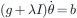

# 变分实时演化（VarQRTE）

`VarQRTE` 用参数化量子态近似时间无关 Hamiltonian 生成的实时演化

<p align="center">
  
</p>

本实现采用消除全局相位自由度后的 McLachlan 变分投影。对拟设态
，每一步计算相位规范不变的投影量子几何张量

<p align="center">
  
</p>

取实部得到度规 ，并构造实时驱动力

<p align="center">
  
</p>

参数速度由

<p align="center">
  
</p>

确定，然后使用固定步长 Forward Euler 更新
。这里的正号和驱动力虚部是实时
McLachlan 方程的组成部分，不能替换为虚时演化所使用的能量梯度方程。

## 组件与数值边界

QGT、Hamiltonian 作用和实时驱动力始终由态矢量精确计算：

- `observable_shots=None` 时，能量和辅助观测请求精确结果；
- 指定 `observable_shots` 时，只有返回轨迹中的能量和辅助观测量使用注入
  Estimator 的有限-shot 语义；参数轨迹保持不变；
- `seed` 只派生轨迹观测请求的随机种子，不参与 QGT、驱动力或参数更新；
- `regularization=0` 对奇异度规使用最小范数最小二乘解；正值则求解
  ，其中  为 `regularization`。

算法复用 `StatevectorQGT` 的参数分析与态导数规则。活跃参数可出现在受支持的旋转、
相位、受控旋转和 `U` 门的仿射表达式中。测量、重置、延迟、动态经典控制、嵌套
线路门、非线性参数表达式和未支持的参数化门会被拒绝。态矢量和每个参数的导数态
均随量子比特数指数增长，因此当前实现面向可精确生成态矢量的规模。

当前实现仅支持时间无关 Hamiltonian 和固定步长 Forward Euler，不提供自适应积分、
高阶积分、时间排序或积分误差估计。更小步长通常降低离散误差，但会增加 QGT 和
驱动力计算次数。正则化或表达能力不足的拟设会改变投影后的轨迹。

`VarQRTE` 与 `PVQD` 解决相同类型的实时演化任务，但数值路线不同：`VarQRTE` 在
当前点直接求解局部 McLachlan 方程；`PVQD` 则逐步优化拟设态，使其接近短时间演化
目标态。两者不是彼此的别名。

## 结果

`VarQRTEResult` 的 `times`、`parameters` 和 `energies` 均包含初始点；命名
`observables` 也遵循同一时间网格。`evolved_circuit` 是最终参数完全绑定后的独立
线路，`final_parameters` 和 `final_energy` 分别提供轨迹末项的便捷视图。

## 示例

下面使用单量子比特  拟设在 Pauli-Y Hamiltonian 下演化。该问题的
投影方程给出 ，因此总时间  后参数从  演化到约 ：

```python
from cqlib.qis import PauliString

from cqlib_algorithms import VarQRTE
from cqlib_algorithms.operators import RealAmplitudesAnsatz, StatevectorEstimator

ansatz = RealAmplitudesAnsatz(1, reps=0)
template = ansatz.build_circuit("theta")
initial = {name: 0.3 for name in template.used_symbols}

result = VarQRTE(StatevectorEstimator(), ansatz).evolve(
    PauliString.from_str("Y"),
    initial,
    0.1,
    num_timesteps=10,
    auxiliary_operators={"z": PauliString.from_str("Z")},
    seed=7,
)

print(result.final_parameters)
print(result.final_energy.expectation)
print([item.expectation for item in result.observables["z"]])
```

相位规范修正的 McLachlan 变分模拟方程见 Yuan 等人的
[Theory of variational quantum simulation](https://doi.org/10.22331/q-2019-10-07-191)；
变分实时演化及其几何量计算背景亦可参考 Gacon 等人的
[Variational quantum time evolution without the quantum geometric tensor](https://doi.org/10.1103/PhysRevResearch.6.013143)。
