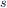
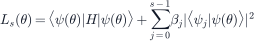
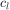
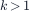

# 变分量子消胀法（VQD）

`VQD` 通过依次惩罚与已找到低能态的重叠，估计 Hermitian 算子的多个低能态。第
 级优化的目标为

<p align="center">
  
</p>

正的  抑制优化器重新收敛到先前状态。该方法来源于 Higgott、Wang 与
Brierley 的
[Variational Quantum Computation of Excited States](https://doi.org/10.22331/q-2019-07-01-156)。

## 组件组合

算法只组织四类公共组件：`Ansatz` 构建每一级共用的参数化线路，`Estimator` 计算
能量和辅助可观测量，`StateFidelity` 计算与先前状态的平方重叠，`Optimizer`
最小化复合目标。当前 `ComputeUncomputeFidelity` 是可直接使用的保真度实现；算法
不绑定具体 Sampler、Estimator 或优化方法。

优化器中使用的 Estimator 变换必须保持拟设线路的量子比特数。参数移位、
有限差分和 SPSA 梯度均满足该条件。当前的线性组合梯度会增加辅助量子比特，
因而无法与已保存的参考态直接比较；算法会显式拒绝这条路径，而不会省略重叠惩罚。

`k` 指定请求的状态数量，不能超过线路 Hilbert 空间维数。一个初始参数映射会在每
一级独立复用，也可以按级提供 `k` 个映射。每个映射必须精确绑定实际线路的全部活跃
符号。VQD 不自动扩大拟设，也不保证拟设能够表示目标本征态或优化器找到全局最优点。

## Penalty 与结果

显式 `betas` 必须包含  个有限正数。省略时，算法采用
 作为统一 penalty，其中  是 Hamiltonian 的 Pauli
系数；这是保守默认值而非问题相关最优值。过小的 penalty 可能使多个级别收敛到同一
低能态，过大的 penalty 会恶化目标尺度。零 Hamiltonian 在  时没有可推导
尺度，必须显式给出 penalty。

`VQDResult.eigenvalues` 保存最终线路的原始 Hamiltonian 期望值；
`optimal_values` 保存包含重叠 penalty 的优化目标，两者不能混用。结果还保留每一级
的不可变参数映射、完全绑定线路、优化器元数据、实际 penalty 以及按“状态 × 辅助
算子”排列的结果。

有限 shots 下，能量、重叠和辅助结果都是统计估计。`seed` 为每一级能量、
保真度和辅助观测派生可复现的请求种子；梯度和优化器产生的同一目标派生请求
保留该目标的父种子。因此，使用支持种子的本地组件时，相同输入可复现相同执行轨迹；
实际硬件后端可以不支持确定性复现。算法
不会按带噪能量重新排序结果，因为这样会破坏能量、线路与优化记录的对应关系。

## 示例

下面估计单量子比特  的两个本征态：

```python
import math

from cqlib.qis import PauliString

from cqlib_algorithms import VQD
from cqlib_algorithms.operators import (
    COBYLAOptimizer,
    ComputeUncomputeFidelity,
    RealAmplitudesAnsatz,
    StatevectorEstimator,
    StatevectorSampler,
)

algorithm = VQD(
    StatevectorEstimator(),
    ComputeUncomputeFidelity(StatevectorSampler()),
    RealAmplitudesAnsatz(1, reps=0),
    COBYLAOptimizer(maxiter=100, tolerance=1e-8),
    k=2,
    betas=(4.0,),
)
result = algorithm.compute_eigenvalues(
    PauliString.from_str("Z"),
    [{"theta_0": 2.5}, {"theta_0": 0.3}],
    fidelity_shots=4096,
    seed=7,
)

assert abs(result.eigenvalues[0] + 1.0) < 1e-6
assert abs(result.eigenvalues[1] - 1.0) < 2e-3
```

后一级依赖前一级的近似状态，因此拟设误差、有限-shot 误差和优化误差会逐级传播。
需要可靠激发态时，应同时检查能量收敛、状态间重叠以及不同初始点和 penalty 下的
稳定性。
