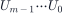
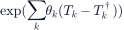
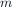
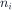
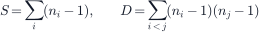
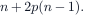
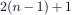
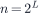
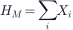

# Ansatz 与 QAOA 演化层

本页用于选择和组合已实现的变分线路。所有具体组件实现公共 `Ansatz` 协议，每次
构建返回独立 `Circuit`；构造参数和异常以源码 docstring 为准。

## 公共约定

- 公共构建流程统一校验 prefix、组件配置和生成的 Core 线路。
- `num_qubits` 必须是大于零的 Python `int`，`bool` 不作为整数接受。
- `reps` 必须是非负 Python `int`。`reps=0` 是合法退化配置。
- `prefix` 必须是字符串，用于为新建的符号参数命名。
- TwoLocal 系列默认纠缠拓扑为 `EntanglementTopology.linear()`；其他组件的默认值
  在各自章节说明。
- TwoLocal 系列的参数顺序为“旋转层、量子比特、该量子比特上的旋转门位置”。

## TwoLocal 系列

### `TwoLocalAnsatz`

```python
from cqlib.circuit.ansatz import EntanglementTopology
from cqlib.circuit.gates import StandardGate
from cqlib_algorithms.operators import TwoLocalAnsatz

ansatz = TwoLocalAnsatz(
    4,
    reps=2,
    rotation_gates=(StandardGate.RY, StandardGate.RZ),
    entanglement_gate=StandardGate.CX,
    entanglement=EntanglementTopology.circular(),
)
circuit = ansatz.build_circuit("theta")
```

它直接组合并委托 Core `TwoLocal`。旋转门只允许未绑定的 `RX`、`RY`、`RZ`，
纠缠门只允许未绑定的 `CX`、`CY`、`CZ`。每个 repetition 包含一个旋转层和一个
纠缠层；默认在末尾增加一个旋转层。参数数量为

<p align="center">
  
</p>

其中  是量子比特数， 是旋转门种类数， 是 repetition 数，
 表示是否保留末尾旋转层。

空 `rotation_gates` 合法，此时线路可以只包含纠缠门。

### `RealAmplitudesAnsatz`

`RealAmplitudesAnsatz` 将 TwoLocal 固定为 `RY` 旋转与 `CX` 纠缠。所有固定参数下
的门矩阵均为实数。参数数量为
。

### `EfficientSU2Ansatz`

`EfficientSU2Ansatz` 将每个单比特参数块固定为依次执行 `RY`、`RZ`，纠缠门固定为
`CX`。参数数量为
。

### `HardwareEfficientAnsatz`

`HardwareEfficientAnsatz` 是本库冻结的一种数字门模型实现：每个单比特参数块为
`RZ`、`RX`、`RZ` Euler 序列，之后按 Core 拓扑执行 `CX`、`CY` 或 `CZ` 纠缠。
参数数量为
。

“硬件高效拟设”并没有唯一线路定义；这个组件不会自动查询设备、选择本征门或执行
拓扑映射。调用方应传入与目标设备相符的 `EntanglementTopology` 和纠缠门，后续仍需
经过编译和映射流程。

## `TwoQubitUnitaryAnsatz`

该组件提供固定宽度为 2 的局域变分块，适合用作更大线路中的可训练双量子比特层。
它有两个相互独立的选项：`parameterization` 选择低深度 `simple` 或表达能力更强的
`general`，`structure` 选择矩阵为实数的 `real` 或允许复数振幅的 `complex`。

| 模式 | 参数数 | 固定纠缠结构 | 表达边界 |
| --- | ---: | --- | --- |
| simple + real | 2 | `CX(0 -> 1)` | 两个 RY 与一个 CX 组成的低深度实矩阵子族 |
| simple + complex | 2 | `CX(0 -> 1)` | RX、RY 与一个 CX 组成的低深度复矩阵子族 |
| general + real | 6 | 两个 `CX(1 -> 0)` | 覆盖连通的  实正交矩阵族 |
| general + complex | 15 | `CX(1 -> 0)`、`CX(0 -> 1)`、`CX(1 -> 0)` | 在忽略全局相位时覆盖一般双量子比特酉变换 |

```python
from cqlib_algorithms.operators import TwoQubitUnitaryAnsatz

block = TwoQubitUnitaryAnsatz(
    parameterization="general",
    structure="complex",
)
circuit = block.build_circuit("unitary")
```

参数按门在线路中出现的顺序命名为 `unitary_0`、`unitary_1` 等。量子比特 0 遵循
Cqlib 的小端约定，是计算基  的最低有效位；上表箭头左侧为 CX 控制位，
右侧为目标位。`simple` 只是一种两参数启发式结构，不能表示任意实或复的双量子比特
酉矩阵；`general + real` 只覆盖行列式为  的连通实正交分支；
`general + complex` 的 15 个参数描述忽略全局相位后的自由度。本组件不接受目标矩阵，
也不负责矩阵综合、辅助量子比特、重复层或把局域块铺设到多量子比特拓扑。

## `PauliTwoDesignAnsatz`

该组件先在每个量子比特上执行 ，然后执行  个参数化旋转层。
每个参数槽的旋转轴在构造时从 `RX`、`RY`、`RZ` 中均匀抽样一次并冻结。前
`reps` 个旋转层之后依次执行偶边  和奇边
 的 `CZ` brickwork 纠缠层。

```python
from cqlib_algorithms.operators import PauliTwoDesignAnsatz

ansatz = PauliTwoDesignAnsatz(4, reps=2, seed=7)
circuit = ansatz.build_circuit("theta")
```

参数顺序为“旋转层、量子比特”，数量为 。相同的非空
`seed` 在本实现的不同实例间生成相同轴序列；同一实例重复构建始终确定。
`seed=None` 允许不同实例使用不同轴。不同实现或不同随机数生成器即使使用相同
seed，也不保证产生相同的随机轴序列。

## 算符演化系列

### 晶格守恒拟设

`FermionicHoppingAnsatz` 表示单个复 hopping 的精确参数化演化。它固定采用
Jordan--Wigner 直接占据编码，通过数目相位共轭把复 hopping 归约为两个严格对易的
实 hopping Pauli 项，因此非相邻模式的奇偶串和复相位都被完整保留。

`FermiHubbardAnsatz` 先制备与 `FermionicSector` 一致的计算基配置；每层按格点边和
up/down 顺序作用独立 hopping 因子，再精确演化全部对角在位势与 onsite interaction。
这是一种有序 Hamiltonian-inspired 因子线路，不把非对易 hopping 总和当成单次精确
演化。线路的变分部分严格保持  与 。

`SpinExchangeAnsatz` 从守恒自旋系统的非零晶格边构造拓扑，并复用
`ExcitationPreservingAnsatz`。它要求显式 `SpinMagnetizationSector` 和匹配参考配置，
支持 iSWAP-like 与 fSim-like 模式，严格保持总 。

### `EvolvedOperatorAnsatz`

对有序 Hermitian Hamiltonian 序列 ，每个 repetition 按输入
顺序追加

<p align="center">
  
</p>

参数按 repetition、operator 排列并
命名为 `{prefix}_0, {prefix}_1, ...`，总数为 。所有 Hamiltonian 在
构造时必须满足有限、Hermitian、非空和同宽约束。

```python
from cqlib.circuit.ansatz import EvolutionStrategy
from cqlib.qis import Hamiltonian, PauliString
from cqlib_algorithms.operators import EvolvedOperatorAnsatz

zz = Hamiltonian.from_list([(PauliString.from_str("ZZ"), 1.0)])
x = Hamiltonian.from_list([(PauliString.from_str("IX"), 1.0)])
ansatz = EvolvedOperatorAnsatz(
    [zz, x],
    reps=2,
    strategy=EvolutionStrategy.auto(1),
)
circuit = ansatz.build_circuit("theta")
```

默认 `remove_identity_operators=True`，纯 identity Hamiltonian 因只产生全局相位而
不占参数槽；如果参数化全局相位本身需要保留，可将其设为 `False`。若全部算符被
移除或 `reps=0`，返回保持原寄存器宽度的无参数 identity 线路。

### `UCCAnsatz` 与 `UCCSDAnsatz`

`UCCAnsatz` 接收有序费米激发或共享一个参数的实系数分组生成元。序列项 `k` 的
Core Hermitian 生成元为 ，线路在时间顺序中依次追加

<p align="center">
  
</p>

因此输入  的激发酉矩阵是 ；若配置固定初态线路
，完整线路矩阵是 。这是有序分解的 disentangled UCC；
未配置初态时 。当生成元不对易时，该乘积一般不等于
。输入顺序具有物理意义，重复激发也保留为不同参数
因子。每个费米生成元只映射一次，映射结果被冻结；因子使用 Core 精确 Pauli 演化。
若一个映射后生成元内部包含不对易 Pauli 项，构造器会拒绝它，而不会在该因子内部
静默引入乘积公式近似。参数稳定命名为 `{prefix}_theta_0, ...`。

`UCCSDAnsatz` 从 `ElectronicOccupation` 生成保持 alpha、beta 电子数的单激发和
双激发，并按稳定的“单激发在前、双激发在后”顺序委托 `UCCAnsatz`。未显式提供
固定初态时，它用同一映射器构造 Hartree--Fock 参考态。该构造保持总粒子数和
，但不是保持  的自旋适配拟设。
自定义固定初态必须构建无活跃参数、宽度一致且可由 Core 静态求逆的线路；测量、
重置及包含这类操作的嵌套线路会在构造时被拒绝。该检查验证可组合线路能力，
不宣称对任意自定义矩阵执行额外的数值幺正性证明。
显式激发序列以及自动生成的 UCCSD 激发池都必须非空；真空或满占据等无激发配置
会被拒绝，而不是隐式构造无参数参考态线路。

```python
from cqlib_algorithms.extension.electronic_structure import ElectronicOccupation
from cqlib_algorithms.operators import UCCSDAnsatz

occupation = ElectronicOccupation.closed_shell(2, 2)
ansatz = UCCSDAnsatz(occupation)
circuit = ansatz.build_circuit("ucc")
```

### `UVCCAnsatz` 与 `UVCCSDAnsatz`

`UVCCAnsatz` 接收作用于同一 `ModalSpace` 的有序 `VibrationalExcitation`。对
excitation  的 modal 转移算符 ，它构造

<p align="center">
  
</p>

 先由 `OneHotVibrationalMapper` 精确映射，再交给公共
`EvolvedOperatorAnsatz` 的精确 Pauli 演化。输入顺序、重复 excitation 和重复层均
保留；每个位置使用独立参数。若有  个 excitation 和 ，参数数目为
，命名为 `{prefix}_theta_0, ...`。初态只在全部演化因子之前准备一次。

`UVCCSDAnsatz` 是固定的 VSCF 相对单、双激发组合：先枚举所有单激发，再枚举作用于
两个不同 mode 的全部双激发。若每个 mode 有  个 modal，则单激发数和双激发数
分别为

<p align="center">
  
</p>

默认初态为同一参考构型的 `VSCFStatePreparation`，也可提供宽度相同、无活跃参数且
静态可逆的固定初态。每个生成元只在所属 mode 内移动 one-hot 占据，因此线路保持
每个 mode 恰有一个 modal 的物理子空间。`reps=0` 时只保留固定初态。

```python
from cqlib_algorithms.extension.vibration import ModalSpace
from cqlib_algorithms.operators import UVCCSDAnsatz

space = ModalSpace((3, 3, 2))
ansatz = UVCCSDAnsatz(space, reps=2)
circuit = ansatz.build_circuit("uvcc")
```

### `PUCCDAnsatz` 与 `PUCCSDAnsatz`

`PUCCDAnsatz` 面向非空、非满的闭壳层参考占据。对每个占据空间轨道 `p` 和虚空间
轨道 `q`，它构造配对双激发

<p align="center">
  
</p>

激发按 `p`、`q` 字典序排列，每个激发对应一个参数和一个精确演化因子。

`PUCCSDAnsatz` 使用固定的 generalized spin-adapted s-UPS 生成元池。对每个空间轨道
对 ，先生成共享同一参数且系数均为 1 的 alpha/beta 互补单激发组，再生成一个
配对双激发。线路顺序固定为全部分组单激发在前、全部配对双激发在后，参数数量为

<p align="center">
  
</p>

两种线路都委托 `UCCAnsatz`，所以其矩阵是按输入时间顺序形成的有序因子乘积，一般
不等于生成元加权和的整体指数。`PUCCSDAnsatz` 的每个因子及完整线路保持粒子数、
 与 。它提供固定池和固定因子顺序，不执行离散顺序优化、轨道优化或
repetitions。默认初态为使用同一映射器构造的闭壳层 Hartree--Fock 占据；自定义固定
初态仍须满足 `UCCAnsatz` 的宽度、无活跃参数和静态可逆约束。

```python
from cqlib_algorithms.extension.electronic_structure import ElectronicOccupation
from cqlib_algorithms.operators import PUCCDAnsatz, PUCCSDAnsatz

occupation = ElectronicOccupation.closed_shell(2, 2)
paired_doubles = PUCCDAnsatz(occupation).build_circuit("pair")
spin_adapted = PUCCSDAnsatz(occupation).build_circuit("spin")
```

### `HamiltonianVariationalAnsatz`

单一 Hamiltonian 输入会复用 `CommutingObservableGrouping`，按稳定 first-fit 规则
划分全局对易块；每块使用一个独立演化参数。也可以传入显式的有序 Hamiltonian 块
序列，此时每块必须内部对易，不要求不同块之间对易。分组后全部线路构造、identity
移除和参数管理委托 `EvolvedOperatorAnsatz` 的精确演化配置。

```python
from cqlib.qis import Hamiltonian, PauliString
from cqlib_algorithms.operators import HamiltonianVariationalAnsatz

problem_hamiltonian = Hamiltonian.from_list(
    [
        (PauliString.from_str("XX"), 0.7),
        (PauliString.from_str("ZZ"), -0.4),
    ]
)
ansatz = HamiltonianVariationalAnsatz(problem_hamiltonian, reps=2)
circuit = ansatz.build_circuit("hva")
```

自动分组只依据 Pauli 项的代数对易关系，不承诺所得块数最少，也不根据具体物理模型
重新排序项。显式块适合调用方已经具有物理分解的情况。

## `ExcitationPreservingAnsatz`

该组件交替执行局域 RZ 层和保持计算基总激发数的交换块。每条拓扑边共享一个参数：

<p align="center">
  
</p>

`mode="fsim"` 时再追加一个独立参数的受控 `Phase(-phi)`。默认拓扑为 full，
而不是 TwoLocal 系列的 linear。`skip_unentangled_qubits=True` 会从 RZ 层排除未出现在
任何边中的量子比特；`skip_final_rotation_layer=True` 会省略最后的 RZ 层。

```python
from cqlib.circuit.ansatz import EntanglementTopology
from cqlib_algorithms.operators import ExcitationPreservingAnsatz

ansatz = ExcitationPreservingAnsatz(
    4,
    reps=2,
    mode="fsim",
    entanglement=EntanglementTopology.linear(),
)
circuit = ansatz.build_circuit("theta")
```

若参与 RZ 层的量子比特数为 `r`、边数为 `e`，参数数目为

<p align="center">
  
</p>

其中 iswap 模式每边一个参数，fsim 模式每边两个参数。线路保持输入态的 Hamming
weight；若从全零态直接开始，它不会自行产生非零激发，因此实际使用通常需要先制备
目标激发数的参考态。

## 结构与随机基线

### `SimplifiedTwoDesignAnsatz`

线路先在每个量子比特上施加一个可训练 RY。每个 repetition 先访问 even 最近邻边，
再访问 odd 最近邻边；每条边依次执行 CZ、左端 RY、右端 RY。参数完全按门出现顺序
编号，总数为

<p align="center">
  
</p>

该结构用于可训练性和变分线路基准，是确定性的简化 two-design 结构，不表示任意
有限宽度和深度都形成严格 unitary two-design。

### `RandomLayersAnsatz`

每层包含恰好 `rotations_per_layer` 个参数化旋转；在每个旋转之前，以
`entanglement_ratio` 的概率最多插入一个随机有向双量子比特纠缠门。因此每层门数
不超过 。旋转轴、目标量子比特、纠缠边和门顺序全部在
组件构造时抽样并冻结。

```python
from cqlib_algorithms.operators import RandomLayersAnsatz

ansatz = RandomLayersAnsatz(
    5,
    reps=3,
    rotations_per_layer=5,
    entanglement_ratio=0.25,
    seed=17,
)
circuit = ansatz.build_circuit("random")
```

`seed` 默认为 42；相同配置和 seed 产生相同架构。`seed=None` 允许不同实例随机，
但同一实例重复构建仍保持不变。`entanglement_ratio` 必须满足 ；
值为 1 时，每个多量子比特旋转槽前恰有一个纠缠门。单量子比特线路始终禁用纠缠
抽样。参数数量固定为
，随机插入的纠缠门不增加参数。

## 张量网络启发式线路

`MPSAnsatz`、`TTNAnsatz` 与 `MERAAnsatz` 统一使用双参数局域块：先在边的左右量子
比特分别施加独立 `RY`，再执行左控右靶的 CX。参数严格按门出现顺序命名为
`{prefix}_0`、`{prefix}_1` 等。它们提供的是受张量网络连接结构启发的幺正变分线路，
不导入任意经典张量、不管理键维数，也不声称实现张量收缩。

### `MPSAnsatz`

`MPSAnsatz(num_qubits)` 要求至少两个量子比特，并按
 从左到右对每条链边应用一次局域块。参数数量为
。

### `TTNAnsatz`

`TTNAnsatz(num_qubits)` 在每层从左到右配对活跃量子比特，应用局域块后保留每对的
右量子比特；奇数宽度时将最后一个未配对量子比特带入下一层。归约到根后增加一个
可训练 RY。所有量子比特仍保留在线路中，“保留”只定义后续连接。共有  个
双量子比特块，参数数量为 ，最终根为量子比特 。

### `MERAAnsatz`

`MERAAnsatz(num_qubits)` 要求宽度至少为 2 且为 2 的幂。每个尺度先在相邻配对边界
应用解纠缠位置块，再在  应用等距位置块，并保留每对右侧
量子比特进入下一尺度；最后在根上增加一个可训练 RY。两类位置都使用相同的幺正
局域块但参数互不共享，并不表示公开任意非幺正等距张量。对 ，块数为
，参数数量为 。

```python
from cqlib_algorithms.operators import MERAAnsatz, MPSAnsatz, TTNAnsatz

mps = MPSAnsatz(4).build_circuit("mps")
ttn = TTNAnsatz(5).build_circuit("ttn")
mera = MERAAnsatz(8).build_circuit("mera")
```

## QAOA 单层演化

`QAOACostEvolution` 构造

<p align="center">
  
</p>

并将唯一参数命名为 `{prefix}_gamma`。`QAOAMixerEvolution` 构造

<p align="center">
  
</p>

并将唯一参数命名为 `{prefix}_beta`。后者默认使用横场混合哈密顿量
，也可接收同宽的自定义 Hermitian `Hamiltonian`。

```python
from cqlib.qis import Hamiltonian, PauliString
from cqlib_algorithms.operators import QAOACostEvolution, QAOAMixerEvolution

cost = Hamiltonian(2)
cost.add_term(PauliString.from_str("ZZ"), 0.5)

cost_layer = QAOACostEvolution(cost).build_circuit("qaoa")
mixer_layer = QAOAMixerEvolution(2).build_circuit("qaoa")
```

默认 `EvolutionStrategy.auto(steps=1)`：对相互对易项使用精确乘积，对不对易项使用
一阶 Lie–Trotter。也可以显式传入 Core `EvolutionStrategy`。组件仅表示单个成本层
或混合层，不包含初态、层间参数管理和完整 QAOA 线路。

## 理论与接口参考

- Farhi、Goldstone、Gutmann，
  [A Quantum Approximate Optimization Algorithm](https://arxiv.org/abs/1411.4028)，
  给出交替成本与混合哈密顿量演化的 QAOA 定义。
- Kandala 等，
  [Hardware-efficient Variational Quantum Eigensolver for Small Molecules and Quantum Magnets](https://arxiv.org/abs/1704.05018)，
  说明按设备可用相互作用设计浅层变分线路的思想。
- Grant 等，
  [Hierarchical quantum classifiers](https://doi.org/10.1038/s41534-018-0116-9)，
  给出层次量子分类器中的低深度双量子比特参数块。
- Vatan 与 Williams，
  [Optimal quantum circuits for general two-qubit gates](https://doi.org/10.1103/PhysRevA.69.032315)，
  给出一般复双量子比特酉与实正交双量子比特变换的最优 CNOT 分解框架。
- Nakata 等，
  [Unitary 2-designs from random X- and Z-diagonal unitaries](https://arxiv.org/abs/1502.07514)，
  以及 McClean 等，
  [Barren plateaus in quantum neural network training landscapes](https://arxiv.org/abs/1803.11173)，
  是 Pauli two-design 类随机线路的理论和应用参考。
- Wecker 等，
  [Progress towards practical quantum variational algorithms](https://arxiv.org/abs/1507.08969)，
  给出 Hamiltonian 变分线路的物理启发式组织方法。
- Gard 等，
  [Efficient symmetry-preserving state preparation circuits for the variational quantum eigensolver algorithm](https://arxiv.org/abs/1904.10910)，
  说明固定粒子数子空间中变分线路的价值及守恒结构。
- Romero 等，
  [Strategies for quantum computing molecular energies using the unitary coupled cluster ansatz](https://doi.org/10.1088/2058-9565/aad3e4)，
  讨论量子计算中的酉耦合簇构造、映射和线路组织。
- O'Malley 等，
  [Scalable Quantum Simulation of Molecular Energies](https://doi.org/10.1103/PhysRevX.6.031007)，
  展示分解酉耦合簇线路在变分分子能量计算中的使用。
- McArdle 等，
  [Digital quantum simulation of molecular vibrations](https://doi.org/10.1039/C9SC01313J)，
  给出 one-hot modal 编码、VSCF 参考和酉振动耦合簇线路的组合方式。
- Sokolov 等，
  [Quantum Orbital-Optimized Unitary Coupled Cluster Methods in the Strongly Correlated Regime](https://arxiv.org/abs/1911.10864)，
  给出闭壳层占据轨道到虚轨道的配对双激发构造，是本文 `PUCCDAnsatz` 激发池的依据。
- Burton 等，
  [Exact electronic states with shallow quantum circuits through global optimisation](https://arxiv.org/abs/2207.00085)，
  给出本文固定 `PUCCSDAnsatz` 使用的自旋适配 paired s-UPS 元素。
- Cerezo 等，
  [Cost function dependent barren plateaus in shallow parametrized quantum circuits](https://arxiv.org/abs/2001.00550)，
  给出本文采用的简化 two-design 线路结构和可训练性分析。

这些论文用于核对数学结构和接口组织。本项目的默认值、随机序列和门顺序以本文档
及 Cqlib 公共协议为准。
