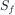
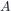
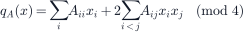
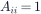
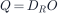
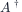
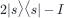
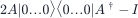

# 线路组合组件

本文档说明 `cqlib_algorithms.operators.composite` 中由基础算子组合而成的复合
算子。它们也可从 `cqlib_algorithms.operators` 导入；具体算子不从包顶层导出。
所有 `build_circuit()` 调用都返回新的 Cqlib `Circuit`，不执行采样、测量或后端
任务。组件只负责可复用的线路组合；算法承诺、执行策略和经典后处理仍由算法层负责。

## Hadamard 相位查询

`HadamardPhaseQuery(function, output_mask=None)` 构建未测量线路
。 完全复用
`PhaseOracle`，因此单输出函数和多输出
`output_mask` 奇偶归约的类型、端序与边界语义都与基础 Oracle 一致。该组件不判断
函数是否满足常/平衡或线性承诺，也不追加测量；Deutsch-Jozsa、
Bernstein-Vazirani 及后续同类查询算法可在其上实现各自的采样与经典判定。

这条现有组合链路同时就是 Deutsch-Jozsa/Bernstein-Vazirani 的 Oracle 构造能力：
`BooleanFunction` / `BooleanVectorFunction` 表示经典函数，`PhaseOracle` 将其变换为
相位 Oracle，`HadamardPhaseQuery` 再组成完整查询线路，因此不另设语义重复的
“DJ/BV Oracle Constructor”类型。需要保留显式输出寄存器的标准 XOR Oracle 时，
使用基础算子 `BitFlipOracle`。

```python
from cqlib_algorithms.operators import HadamardPhaseQuery
from cqlib_algorithms.operators.oracle import BooleanFunction

function = BooleanFunction.from_truth_table([False, True, True, False])
query = HadamardPhaseQuery(function).build_circuit()
```

## 隐藏线性函数电路

`HiddenLinearFunctionCircuit(adjacency_matrix)` 根据非空、方形、对称的二进制矩阵
 构建未测量线路 。
矩阵的第  行和第  列对应
量子比特 `i`；量子比特 `0` 是 Cqlib 计算基索引的最低有效位。对二进制向量
`x`，二次型定义为

<p align="center">
  
</p>

中间对角线路满足 ：对角元素  对应量子
比特  上的 `S` 门，非对角元素  对应 `CZ(i,j)`。输入矩阵在构造
时复制为只读快照，后续修改调用方矩阵不会改变组件；每次 `build_circuit()` 都返回
新的线路。

从全零态运行并测量时，所有可能输出 `z` 都满足：对二进制零空间
`Ker(A)` 中的任意 ，有 。本组件只构建查询
线路，不追加测量、Sampler 或经典解验证。

```python
from cqlib_algorithms.operators import HiddenLinearFunctionCircuit

adjacency_matrix = [
    [1, 1, 0],
    [1, 0, 1],
    [0, 1, 1],
]
query = HiddenLinearFunctionCircuit(adjacency_matrix)
circuit = query.build_circuit()
```

构造器接受任意对称二进制矩阵。Bravyi、Gosset 与 Koenig 的浅线路量子优势结论
还要求问题图具有规定的二维局域结构，并依赖可并行的门调度；仅构造本组件不能据此
声称任意矩阵都具有常深度优势。理论背景见
[Quantum advantage with shallow circuits](https://arxiv.org/abs/1704.00690)。

## Grover 迭代单元

`GroverOperator(oracle, state_preparation=None, reflection_qubits=None)` 构建一次
完整的 Grover 迭代

， 为搜索寄存器上的相位 Oracle。对选定量子比特集合 ，
 是“ 中所有量子比特均为零”的子空间投影，
，而 。返回线路的时间
顺序为 Oracle、、、。部分文献写作 ，两者只差一个
全局相位；本组件采用不带前置负号的约定，并保证矩阵意义上的精确全局相位。

`oracle` 必须是作用在搜索寄存器上的合法、可静态求逆的 Cqlib `Circuit`，量子比特
 为最低有效位。典型输入是 `PhaseOracle(function).build_circuit()`。振幅放大
假设酉 Oracle，因此包含测量、重置、动态控制等不可静态求逆操作的线路在构造时被
拒绝。非连续源量子比特 ID 按 `Circuit.qubits` 的位置映射到 。

构造器仅验证输入是合法且可静态求逆的线路。它不会通过指数规模的矩阵
分析证明线路必然是对角相位 Oracle；输入是否满足相位 Oracle 语义由调用方负责。

不给出 `state_preparation` 时， 只在 `reflection_qubits` 上作用 Hadamard 门。
当  是全部量子比特时，， 就是
`GroverDiffusion(n)` 的 。当  是真子集时，这是在未反射量子
比特各计算基分块内进行的部分扩散，其  特征子空间维数为
，不是单态反射。

给出 `state_preparation` 时， 是作用于整个搜索寄存器的自定义线路。
仅当  包含所有量子比特时， 才是关于  的单态反射
。当  是真子集时， 是关于
 的子空间反射。`state_preparation` 必须可静态求逆且
量子比特数与 Oracle 一致。

`reflection_qubits` 是搜索量子比特索引的可迭代对象，不允许为空、重复或越界，
布尔值不作为整数接受；构造时排序并冻结为只读元组，重复值直接拒绝而不是
静默去重。省略时选择全部搜索量子比特。

组件不执行迭代次数选择、测量统计或完整搜索算法；这些工作由上层 Grover
算法根据问题规模、解的数量和执行后端完成。

## 可运行示例

```python
from cqlib_algorithms.operators import GroverOperator
from cqlib_algorithms.operators.oracle import BooleanFunction, PhaseOracle

function = BooleanFunction.from_truth_table(
    [False] * 7 + [True]  # 在 3 量子比特上标记 |111>
)
oracle = PhaseOracle(function).build_circuit()

# 标准 Grover 迭代：Oracle + 全扩散
iteration = GroverOperator(oracle).build_circuit()

# 部分扩散：只在量子比特 0 和 2 上反射
partial = GroverOperator(oracle, reflection_qubits=(0, 2)).build_circuit()
```

更多反射与 Oracle 的数学约定见
[布尔 Oracle 与反射算子](oracle.md)。

## QSP 与 QSVT

`QuantumSignalProcessing` 构建单量子比特 SU(2) 信号处理序列。调用方可以直接给出
相位序列，也可以从满足奇偶性、有界性和可分解条件的多项式系数求解相位。
`ProjectorControlledPhase` 提供 QSVT 序列使用的投影控制相位。

`QuantumSingularValueTransformation` 将相位序列与 `BlockEncoding` 组合，对编码矩阵
的奇异值实施多项式变换。`RealValuedQSVT` 提供实多项式入口，并负责 QSP/QSVT
相位约定转换。组件返回线路，不执行输入态制备、测量或结果反演。

相位求解是数值过程。当前 Haah 谱因子分解在约 16 阶以上可能因共轭根配对条件数
恶化而拒绝输入；一般 QSVT 还会继承 `UnitaryMatrixOracle` 的两量子比特 KAK
边界和酉特征分解容差限制。调用方应把这些异常解释为当前综合路径的支持边界，而不是
自动放宽容差或假定目标多项式无效。

```python
import numpy as np

from cqlib_algorithms.operators import QuantumSingularValueTransformation
from cqlib_algorithms.operators.oracle import UnitaryDilation

encoding = UnitaryDilation(np.array([[0.25]], dtype=np.complex128))
operator = QuantumSingularValueTransformation(encoding, phases=(0.0, 0.0))
circuit = operator.build_circuit()
```
