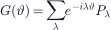
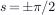
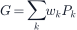
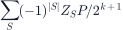

# 微分、量子几何与优化

本页说明变分工作流中梯度、量子几何和经典优化组件的选择。精确接口以源码 docstring
为准。

## 直接从 Ansatz 计算

四种梯度均可调用 `compute(estimator, ansatz, observable, parameter_bindings, ...)`，
返回一个 `GradientResult`，批量计算使用 `run(estimator, requests)`。
`StatevectorQGT.compute(ansatz, bindings)` 和 `StatevectorQFI.compute(ansatz, bindings)`
直接计算所制备纯态的几何量；`NaturalGradient.compute(...)` 返回经度规修正的方向。

```python
import math
from cqlib.qis import PauliString
from cqlib_algorithms.operators import RealAmplitudesAnsatz, StatevectorEstimator
from cqlib_algorithms.operators.gradient import (
    FiniteDifferenceGradient,
    LinCombEstimatorGradient,
    NaturalGradient,
    ParameterShiftGradient,
    SPSAGradient,
    StatevectorQFI,
    StatevectorQGT,
)

ansatz = RealAmplitudesAnsatz(1, reps=0)
point = {"theta_0": 0.4}
observable = PauliString.from_str("Z")
estimator = StatevectorEstimator()
methods = (
    ParameterShiftGradient(),
    LinCombEstimatorGradient(),
    FiniteDifferenceGradient(),
    SPSAGradient(1e-4, seed=7),
)
for method in methods:
    result = method.compute(estimator, ansatz, observable, point)
    print(type(method).__name__, result.values)
print(StatevectorQGT().compute(ansatz, point).metric)  # [[0.25]]
print(StatevectorQFI().compute(ansatz, point).qfi)  # [[1.0]]
direction = NaturalGradient().compute(estimator, ansatz, observable, point)
print(direction.values)  # approximately (-4 * sin(0.4),)
```

该例的目标为 `cos(0.4)`。导数约 `-0.3894183423`，QGT 实部为 `0.25`，QFI 为 `1`；
未正则化的自然梯度约 `-1.5576733692`。自然梯度是更新方向，其数值与普通导数具有不同语义。
有限差分和 SPSA 有步长误差，多个参数时 SPSA 还存在随机方向误差。

默认前缀为 `theta`，绑定必须完整对应构建后实际使用的符号。`parameter_names` 可给出有序子集，
省略时采用活跃符号顺序，空元组产生空结果。重复参数、缺失或多余绑定、非有限值会被拒绝。
组件只在本次请求构造时建立一次并复制，后续求导扰动不会修改用户组件的缓存线路。
传入自定义 Ansatz 时须满足各计算方法的门集和线路结构限制。


## 梯度

- `ParameterShiftGradient`：适用于实现支持的参数化旋转门，使用解析参数移位规则。
- `LinCombEstimatorGradient`：使用线性组合电路估计导数。
- `FiniteDifferenceGradient`：通用数值基线，受步长与舍入误差共同影响。
- `SPSAGradient`：每个方向仅需两次目标评估，适合高维含噪问题，但结果有随机波动。

梯度只对请求中列出的活跃参数求导，参数绑定和结果顺序与请求保持一致。

## 量子几何

`StatevectorQGT` 计算纯态的量子几何张量，`StatevectorQFI` 取其实部并按约定缩放为
量子 Fisher 信息，`NaturalGradient` 求解正则化线性系统获得自然梯度方向。矩阵病态
时应使用显式正则化并检查结果稳定性。

## 优化器

- `GradientDescent`：固定学习率的一阶更新，适合作为透明基线。
- `Adam`：使用一阶、二阶矩估计调整步长。
- `SPSAOptimizer`：用随机同时扰动直接估计目标变化，不依赖 `Gradient` 组件。
- `COBYLAOptimizer`：基于局部线性模型与信赖域的无导数优化，适合导数不可用或
  目标带有限-shot 波动的低至中等维问题。当前 `OptimizerRequest` 不表达通用约束，
  因此该组件只提供无显式约束的参数优化。非零 `maxiter` 至少应为活跃参数数目加二，
  以满足底层 COBYLA 求解器建立初始线性模型所需的最小评估数。
- `LBFGSBOptimizer`：带参数盒约束的有限内存拟牛顿法；可以注入任意 `Gradient`
  实现，也可以由 SciPy 使用前向有限差分估计导数。

停止状态只描述本实现的终止条件，不证明已经达到全局最优解。随机组件应固定 seed
以复现实验；比较不同优化器时应使用相同初值、预算和执行模型。SciPy 求解器正常
终止时返回 `OptimizerStatus.CONVERGED`；迭代或目标评估预算耗尽分别返回
`MAX_ITERATIONS` 或 `MAX_EVALUATIONS`，空参数请求返回 `NO_PARAMETERS`。每个非空
请求的迭代轨迹具有数据依赖，因此同一批请求按输入顺序分别求解，最终点则合并为
一次 Estimator 批量调用重新计算目标值。

L-BFGS-B 的边界按参数名配置，例如 `bounds={"theta": (0.0, 2 * math.pi)}`；未列出的
活跃参数不设界，非活跃参数仍保持请求中的固定绑定。数值差分模式下，SciPy 可能为
一轮梯度计算执行多次目标调用，因此 `maxfun` 只是近似评估预算；需要严格量子调用
预算或解析参数移位时，应显式注入 `ParameterShiftGradient` 等梯度组件。

```python
import math
from cqlib.qis import PauliString
from cqlib_algorithms import VQE
from cqlib_algorithms.operators import RealAmplitudesAnsatz, StatevectorEstimator
from cqlib_algorithms.operators.gradient import ParameterShiftGradient
from cqlib_algorithms.operators.optimizer import COBYLAOptimizer, LBFGSBOptimizer

optimizers = (
    COBYLAOptimizer(maxiter=500, tolerance=1e-6),
    LBFGSBOptimizer(
        ParameterShiftGradient(),
        bounds={"theta_0": (0.0, 2.0 * math.pi)},
        maxiter=200,
    ),
)
for optimizer in optimizers:
    algorithm = VQE(StatevectorEstimator(), RealAmplitudesAnsatz(1, reps=0), optimizer)
    result = algorithm.run(PauliString.from_str("Z"), {"theta_0": 0.4})
    assert result.optimal_value < -0.999
    print(result.optimal_value)
```

这里的 `estimator` 实现 `Estimator`，`optimizer_requests` 是按输出顺序排列的
`OptimizerRequest` 序列。

`cqlib_algorithms.operators.gradient` 提供变分算法所需的最小梯度组件集，
对应组件清单"自然梯度优化（QGT + 梯度）"：

- `ParameterShiftGradient` —— 精确参数移位梯度，显式继承
  `cqlib_algorithms.protocols.gradient.Gradient` 抽象基类；
- `LinCombEstimatorGradient` —— 基于辅助量子比特 Hadamard test 的精确
  线性组合梯度；
- `FiniteDifferenceGradient` —— 前向或中心有限差分梯度；
- `SPSAGradient` —— 每个非空请求固定两次期望值评估的随机梯度估计；
- `StatevectorQGT` / `QGTResult` —— 精确量子几何张量与实度规；
- `StatevectorQFI` / `QFIResult` —— 纯态量子 Fisher 信息矩阵；
- `NaturalGradient` —— 自然梯度方向  的求解器。

数学定义采用 Stokes et al.（arXiv:1909.02108）的对称化约定：
，
。端序遵循 Cqlib
小端约定，量子比特位置按线路插入顺序解释，支持非连续量子比特 ID。

## 参数移位规则

每个参数化门按其分支本征值谱分类
（）：

| 门 | 槽位谱 |
|---|---|
| RX/RY/RZ/RXX/RYY/RZZ/RZX | {±1/2} |
| Phase | {0, −1} |
| CRX/CRY/CRZ 及多控 R*/Phase | {0, ±1/2} |
| U 的 θ 槽 | {±1/2} |
| U 的 φ/λ 槽 | {0, −1} |
| GPhase | 零贡献 |

符号通过仿射表达式（如 ）进入门时，组件对每个门参数槽独立执行
精确局部移位，再按仿射链式系数加权并对同一符号的全部出现点求和。普通
旋转门和相位门的每个出现点使用经典两点规则
（，）；受控旋转的局部频率为 ，每个出现点
使用四点规则。该逐出现点算法避免构造共享符号所有门谱的组合频率集，
因此评估次数随出现点数量线性增长。例如，一个成本参数同时出现在 11 个
普通双量子比特旋转中时，恰好产生 22 次评估。它不使用有限差分降级。
非线性参数表达式（如 ）以及待求导
符号进入不支持的参数化门（XY/XY2P/XY2M/RXY/FSIM、符号化
UnitaryGate）时以 `ValueError` 拒绝，且在任何 estimator 调用之前抛出。
线路中其他已完整绑定、但未列入 `parameter_names` 的参数门作为固定酉演化
保留。CircuitGate 属于当前组件的线路级范围限制，无论是否含待求导符号
都被拒绝。

shots 模式的统计质量取决于底层 Estimator。仅出现在 `set_global_phase` 或
`GPhase` 中的符号梯度恒为零。

## 线性组合梯度（LinCombEstimatorGradient）

该组件采用 Schuld et al.（arXiv:1811.11184）的辅助量子比特线性组合
测量思路。对仿射门参数 ，若生成元分解为
，则在线路参数因子前插入受辅助量子比特控制的 ，
辅助位制备为 ，并测量 ：

。

普通 Pauli 旋转生成元为 ；受  个量子比特控制的 Pauli 旋转展开为
。受控 Phase 的生成元展开为控制位与目标位
上投影算子的 Pauli-Z 线性组合，其中纯单位项不影响 Hermitian 期望值导数，
因此不产生评估。 按执行顺序展开为
，再分别插入对应生成元。PauliString 的 
相位和 Hamiltonian 每个项的相位、系数均会原样扩展到辅助位。

一次普通旋转需要 1 个辅助线路； 控旋转需要  个；具有  个控制位的
受控 Phase 需要  个。该组件支持非连续或重排的量子比特 ID；shots
统计误差由底层 Estimator 决定。

## 数值梯度

`FiniteDifferenceGradient(epsilon=1e-6, method="central")` 不分析门生成元，
因此可用于底层 Estimator 能执行的任意参数化线路。中心差分使用
，每个参数两次评估，截断误差为
；`method="forward"` 使用
，每个参数两次评估，截断误差为
。所有请求的评估点压平为单批，调用方需要结合浮点舍入、shots 噪声和
目标函数尺度选择 `epsilon`。

`SPSAGradient(perturbation, seed)` 对每个非空请求抽取一个 Rademacher 向量
，仅评估  与 ，并返回
。评估数与参数维数无关。整数 seed 可复现；
传入 NumPy `Generator` 时共享其随机流；同一实例的随机状态会随调用推进。
当前实现每次调用只使用一组扰动，不包含多扰动平均。

## QGT（StatevectorQGT）

`StatevectorQGT.compute(request)` 精确计算导数态并返回 `QGTResult`。
`tensor` 为复 Hermitian 张量 ，`metric` 为实对称度规
，两者顺序均与 `parameter_names` 一致。全局相位的导数与
 平行，经投影后不影响结果。
支持的参数化门和线路限制见源码 docstring。

## 自然梯度（NaturalGradient）

`NaturalGradient(regularization=0.0).run(estimator, requests)` 内部执行
单批参数移位梯度 + QGT + 线性求解：

- `regularization=0`：最小范数最小二乘（伪逆），容忍奇异度规；
- ：岭正则 。

它不继承 `Gradient` 抽象基类：其输出是几何修正后的方向，不是期望值
的导数。经典优化循环（迭代、步长调度）不在本组件范围内。

## 量子 Fisher 信息（StatevectorQFI）

纯态约定下 。`StatevectorQFI.compute(request)` 返回
`QFIResult`；矩阵按 `parameter_names` 排列且为有限实对称矩阵。空参数请求返回
 矩阵。自然梯度仍使用 ，改用 QFI 会把相同步长下的方向缩放为四分之一。

## 使用示例

```python
from cqlib import Circuit, Parameter
from cqlib.qis import PauliString

from cqlib_algorithms.protocols import Estimator, EstimatorRequest, GradientRequest
from cqlib_algorithms.operators.gradient import (
    FiniteDifferenceGradient,
    LinCombEstimatorGradient,
    NaturalGradient,
    ParameterShiftGradient,
    SPSAGradient,
    StatevectorQFI,
    StatevectorQGT,
)

theta = Parameter("theta")
circuit = Circuit(2)
circuit.h(0)
circuit.ry(1, theta)
circuit.cx(0, 1)

request = GradientRequest(
    EstimatorRequest(circuit, PauliString.from_str("ZZ"), {"theta": 0.31}),
    ("theta",),
)

qgt = StatevectorQGT().compute(request)
qfi = StatevectorQFI().compute(request)


def evaluate(estimator: Estimator):
    gradient = ParameterShiftGradient().run(estimator, [request])[0]
    lin_comb = LinCombEstimatorGradient().run(estimator, [request])[0]
    finite_difference = FiniteDifferenceGradient().run(estimator, [request])[0]
    spsa = SPSAGradient(perturbation=0.01, seed=7).run(estimator, [request])[0]
    direction = NaturalGradient().run(estimator, [request])[0]
    return gradient, lin_comb, finite_difference, spsa, direction
```

`estimator` 是任何实现 `Estimator` 抽象基类的同步批量精确估计器。

## 已知限制

- CircuitGate（含符号）被拒绝。这是组件当前的线路级范围限制，不是 Core
  参数暴露缺口；显式提供第三个参数绑定后，CircuitGate 的
  `operation.params` 与普通酉子线路 `decompose()` 均可用。支持 CircuitGate
  仍需设计递归展开、链式求导和嵌套位置映射；
- 待求导符号进入符号化 UnitaryGate 时被拒绝；只含未请求参数且已完整绑定
  的门可以作为固定酉演化保留；
- 测量、重置、延时与经典控制指令被拒绝（静态酉线路要求）；
- 数值边界（非线性表达式、非有限值）显式抛 `ValueError`，不做静默
  降级。

## 理论依据

- Schuld et al., *Evaluating analytic gradients on quantum hardware*,
  [arXiv:1811.11184](https://arxiv.org/abs/1811.11184)：辅助量子比特
  线性组合测量以及标准双本征值生成元的两点参数移位规则。
- Wierichs et al., *General parameter-shift rules for quantum gradients*,
  [arXiv:2107.12390](https://arxiv.org/abs/2107.12390)：基于有限 Fourier
  频谱的一般参数移位与函数重构。本实现对每个门槽的局部生成元谱应用精确
  移位，并按多变量链式法则聚合共享符号的出现点。
- Spall, *Multivariate stochastic approximation using a simultaneous
  perturbation gradient approximation*, IEEE Transactions on Automatic
  Control 37(3), 1992：SPSA 的双边同时扰动估计。
- Stokes et al., *Quantum Natural Gradient*,
  [arXiv:1909.02108](https://arxiv.org/abs/1909.02108)：投影 QGT、实部度规
  与自然梯度线性系统。
- Powell, *A direct search optimization method that models the objective and
  constraint functions by linear interpolation*, 1994：COBYLA 的局部线性模型
  与信赖域框架。
- Byrd et al., *A Limited Memory Algorithm for Bound Constrained
  Optimization*, SIAM Journal on Scientific Computing 16(5), 1995：L-BFGS-B
  的有限内存拟牛顿更新与盒约束处理。
