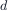
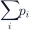

# Mixer 组件

`cqlib_algorithms.operators.mixer` 提供受约束变分线路使用的一参数 Mixer。所有组件都
实现 `Ansatz`，只声明一个逻辑参数，并严格使用 `{prefix}_beta` 作为活跃符号。

## 数学与编码约定

两个 one-hot 位之间的交换生成元固定为

<p align="center">
  
</p>

因此精确局部演化使用  后接 。这一定义保持 Hamming weight，
且没有被忽略的全局相位。one-hot 值 `a` 对应局部量子比特 `a`；复合编码仍采用量子
比特 0 为最低有效位的 Core 约定。

必须区分两类完整 Mixer：

- simultaneous Mixer 是 。当  不对易时，其线路由显式
  `EvolutionStrategy` 决定，默认 `auto(1)` 是一阶乘积近似，不能解释为精确演化。
  实现以完整 XY exchange 为乘积公式的原子项，避免把 XX 和 YY 拆散后离开 one-hot
  子空间；支持 exact、auto、first-order 和 second-order，拒绝会打乱 Pauli 子项的
  randomized 模式。
- partitioned Mixer 是有序乘积 。顺序是定义的一部分，所有
  局部块共享同一个 ；它一般不等于对应 simultaneous Mixer。

实现依据是 Hadfield 等人的 *From the Quantum Approximate Optimization Algorithm to a
Quantum Alternating Operator Ansatz*（arXiv:1709.03489v2）中的 nearby-values、null-swap、
parity、color-parity 和 time-color 构造。

## 公共组件

| 组件 | 宽度 | 语义 |
| --- | ---: | --- |
| `NearbyValuesMixer(d, r, strategy=...)` |  | cyclic -nearby simultaneous one-hot Hamiltonian |
| `RingMixer(d, strategy=...)` |  |  的 nearby-values 预设 |
| `FullyConnectedMixer(d, strategy=...)` |  |  的 nearby-values 预设，保留循环移位重数 |
| `NullSwapMixer(d, null_value=..., strategy=...)` |  |  的完整 simultaneous 演化 |
| `ParityRingMixer(d, repetitions=...)` |  | odd、even、必要时 closing 的精确有序交换层 |
| `ControlledBitFlipMixer(m, control_state=...)` |  | 默认 NOR（全零）控制态上的  |
| `ControlledNullSwapMixer(m, control_state=...)` |  | 默认 NONE（全零）控制态上的精确 null/value 局部交换 |
| `ControlledSwapMixer(m, control_state=...)` |  | 默认 NONE（全零）控制态上的精确 value/value 局部交换 |
| `ValueSelectivePermutationSwapMixer()` |  | 两位置、两值之间的精确四体跃迁 |
| `ValueIndependentPermutationSwapMixer(d)` |  | 两个 direct one-hot 寄存器之间不区分值的交换 |
| `ColorParityPermutationSwapMixer(n, repetitions=...)` |  | direct one-hot 排列的 color × parity 有序 Mixer |
| `TimeSwapMixer(...)` | 见下文 | 固定工作对和起始时间的绝对 one-hot 四体交换 |
| `TimeColorMixer(...)` | 见下文 | 按时间再按完整图 edge color 排序的调度 Mixer |
| `PartitionedMixer(n, parts)` |  | 通用有序局部 Mixer 组合器 |

`NullSwapMixer` 是完整的 simultaneous Hamiltonian Mixer，不表示某一个 null/value 局部
交换。受控的两个类是用于组合完整问题 Mixer 的局部构件。

## 四体排列跃迁

`ValueSelectivePermutationSwapMixer` 的局部量子比特顺序为
。其生成元只连接  与 ，展开为系数
 的八个互相对易 Pauli 四体项，因此线路在完整四量子比特空间上精确。

`ValueIndependentPermutationSwapMixer` 对每个无序值对依次应用上述精确块。不同值对
在 direct one-hot 可行子空间中作用于互不相交的两态扇区，所以该乘积在可行子空间内
等于 value-independent simultaneous 演化；对非法 bitstring 不声明二者相等。

`ColorParityPermutationSwapMixer` 使用  映射量子比特。值对采用
确定性的 round-robin 完整图 edge coloring，位置采用 odd、even、必要时 closing 的
环形 parity 分层；执行顺序固定为 color 在外、parity 在内。

## 绝对时间调度 Mixer

处理时间  必须为正整数，默认 horizon 为 。工作  拥有
 个 one-hot 量子比特，分别表示起始时间
。
`TimeSwapMixer` 精确连接

<p align="center">
  
</p>

`TimeColorMixer` 遍历时间 ，再遍历工作对的确定性 edge color；每个颜色
内的工作对互不相交。无效的  局部块不会生成。

## 通用组合与 QAOA

`MixerApplication(mixer, qubits)` 描述一个局部 Mixer 及其位置映射。
`PartitionedMixer` 允许相邻应用重叠，并严格按输入顺序组合；每个
局部 Mixer 必须恰有一个参数并遵守共享 beta 命名契约。

`QAOA` 保留原有 `mixer_operator=Hamiltonian` 接口，同时新增 `mixer=Ansatz`。两者互斥：
线路 Mixer 已经定义了综合顺序，因此不能再传 `mixer_strategy`。线路 Mixer 必须与成本
寄存器同宽、声明一个参数，并为每层生成恰好 `{prefix}_{layer}_beta`。

```python
from cqlib_algorithms.algorithms import QAOA
from cqlib_algorithms.operators.mixer import ParityRingMixer

# estimator、optimizer 和 cost 由应用注入。
algorithm = QAOA(estimator, optimizer, mixer=ParityRingMixer(4), reps=2)
circuit = algorithm.build_circuit(cost)
```

## 边界

- Mixer 只构造参数化酉线路，不负责选择可行初态、成本函数或优化器。
- simultaneous 非对易误差由调用方选择的受支持 `EvolutionStrategy` 决定；
  randomized Pauli 子项顺序会破坏 exchange 块，因此构造时拒绝。
- 受控组件的 `control_state` 是小端整数；`None` 遵循论文的 NOR/NONE
  谓词，表示所有控制位为 0。显式整数仍可选择任意计算基控制态。
- direct one-hot 与 absolute one-hot 组件仅承诺从合法编码态出发保持相应可行子空间；
  对非法 bitstring 的作用不解释为问题级语义。
- 排列与调度组件的宽度分别按  和绝对时间寄存器规模增长，未引入辅助量子比特。
