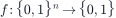
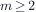
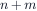
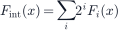
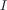
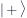
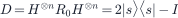
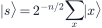
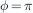

# 布尔 Oracle 与反射算子

本文档说明 `cqlib_algorithms.operators.oracle` 的有限布尔函数 Oracle 和精确反射
线路。它们也可从 `cqlib_algorithms.operators` 导入；具体算子不从包顶层导出。
所有 `build_circuit()` 调用都返回新的 Cqlib `Circuit`，不执行采样、测量或后端任务。

## 函数表示与端序

`BooleanFunction` 是一个不可变的单输出函数 ，其中 。
它可通过 `from_marked_states(n, states)`、`from_truth_table(values)` 或
`from_expression(expression, variable_order=...)` 创建。真值表长度为 ，
`truth_table[x]` 对应输入整数 `x`。表达式只支持变量、`True`、`False`、括号、
`~`、`&`、`^` 和 `|`；它使用受限 AST 解析，不执行 Python 表达式。

`BooleanVectorFunction` 表示 ，要求 、，
各标量输出的 `variable_order` 完全一致。`from_truth_table(rows)` 接收输入优先
的矩形真值表，`rows[x][i]` 为输入 `x` 的输出位 `i`；
`from_marked_state_sets(n, sets)` 则接收输出优先的标记态集合；还可使用
`from_functions(outputs)` 与 `from_expressions(expressions, variable_order=...)`。
字符串表达式或显式 `variable_order` 中第 `i` 个变量对应输入比特 `i`、量子比特
。默认变量顺序在表达式中依首次出现顺序确定，真值表构造默认采用
`("x0", "x1", ...)`。量子比特  是计算基整数的最低有效位。

非法类型通常抛出 `TypeError`，无效长度、输出数量、标记态、变量顺序或掩码通常
抛出 `ValueError`。向量函数不接受只有一个输出；该情况应使用 `BooleanFunction`。
已构造函数是不可变值，`marked_states` 与 `truth_table` 对外提供不可变元组。

## BitFlip 与 Phase 合同

给定 `n` 个输入比特与 `m` 个输出比特，`BitFlipOracle(F)` 构建可逆线路

。

输入寄存器占  至 ，输出位  占 。线路共有  个
量子比特，输出寄存器不被强制初始化；对已有 `y` 也是 XOR，而不是覆盖写入。
单输出函数对应 。此线路是酉的、厄米的、对合的，并不包含辅助量子比特。

`PhaseOracle(f)` 对单输出函数构建

。

多输出 `PhaseOracle(F, output_mask=k)` 必须显式给出整数 ，并满足
；布尔值不是合法掩码。其线路仅包含  个输入量子比特：

，

其中 ，`parity` 是被选输出位的模二和。这是
 的 XOR/奇偶投影，**不是**“任一被选输出为真”的逻辑 OR 标记。
例如，两个被选输出在同一个输入上都为真时，相位为 。如需 OR 谓词，
调用方应先定义相应的单输出 `BooleanFunction`；该组件不会悄然替换标记语义。
对恒真标记，线路显式保留  全局相位；恒假标记返回 。

将 BitFlip 输出位  初始化为 （其余输出位为 ）时，
XOR 的相位回踢与选择  的 Phase Oracle 一致；多个被选位为 
时得到相同的掩码奇偶相位。这不表示 Phase Oracle 持有或测量输出寄存器。

## 精确反射

`ZeroStateReflection(n)` 要求正整数 `n`，返回
，含精确全局相位。`GroverDiffusion(n)` 返回
，其中
；它本身不包含标记 Oracle。

`GeneralStateReflection(A)` 要求非空、Core 可静态求逆的 Cqlib 线路
，并返回 ，
。实际线路时间顺序为
。非连续源量子比特 ID 按 `Circuit.qubits` 的位置映射到
。测量、重置、延时、动态控制等不能静态求逆的操作被拒绝。
参数化线路可先构建反射，再通过 Core 的 `assign_parameters` 绑定。

`GeneralStateReflection.from_state_preparation(component, prefix=...)` 也接受
显式继承本库 `StatePreparation` 抽象基类的组件：先调用 `validate()`，再核验
声明的量子比特数量、参数槽数量及构建线路的可逆性。结构相似但未继承该基类
的对象不满足此入口合同。这是本功能对已有状态制备公共接口的唯一依赖，
不涉及 `Ansatz`。

`GroverLong(n, phase=phi)` 构建 Long 搜索使用的相位匹配扩散算子
。当  时，它得到
，与上述
`GroverDiffusion` 相差一个全局负号。`get_beta()`、`get_it_num()` 和
`get_phi()` 提供已知标记态数量时的 Long 相位匹配公式；该组件只构建扩散线路并
计算参数，不负责构造标记 Oracle、重复迭代或执行完整搜索。

上述反射保持矩阵意义上的全局相位，不能用“仅保真度一致”代替验收。Grover
扩散算子的数学约定可参见 [Grover 的原始论文](https://arxiv.org/abs/quant-ph/9605043)；
这里仅提供算子，不提供完整搜索算法或查询复杂度承诺。

## 任意酉矩阵与块编码

`UnitaryMatrixOracle(U)` 接受有限、方形、维数为  的酉矩阵，并通过递归
Block-ZXZ 分解构建 Cqlib 线路。输入矩阵在构造时复制，`build_circuit()` 返回独立
线路；可选重构检查按全局相位对齐后比较目标矩阵。当前两量子比特叶节点依赖 Core
KAK 分解，Core 对 Weyl chamber 边界  的拒绝会使少数合法矩阵无法
综合。该限制会以异常暴露，不能视为输入矩阵非酉。

`BlockEncoding` 定义块编码组件的公共接口。`UnitaryDilation(A)` 对谱范数不超过 1
的方阵构造酉扩张，使目标矩阵出现在更大酉矩阵的指定块中。它使用稠密数值矩阵，
适合小规模精确构造，不代表稀疏访问 Oracle、QRAM 或渐近最优块编码。

`DickeUnitary`、`SplitCycleShift` 和 `WeightDistributionBlock` 是 Dicke 态制备使用的
可逆权重分布组件。它们公开为可复用线路算子，但不单独执行采样或 Hamming weight
估计。

## 可运行示例

```python
from cqlib import Circuit
from cqlib_algorithms.operators.oracle import (
    BitFlipOracle,
    BooleanFunction,
    BooleanVectorFunction,
    GeneralStateReflection,
    GroverDiffusion,
    PhaseOracle,
)

scalar = BooleanFunction.from_expression("low & ~high", variable_order=("low", "high"))
assert scalar.marked_states == (1,)
scalar_bit_flip = BitFlipOracle(scalar).build_circuit()
assert scalar_bit_flip.num_qubits == 3

vector = BooleanVectorFunction.from_truth_table(
    [(False, False), (True, False), (False, True), (True, True)]
)
vector_bit_flip = BitFlipOracle(vector).build_circuit()
vector_phase = PhaseOracle(vector, output_mask=0b11).build_circuit()
assert vector_bit_flip.num_qubits == 4
assert vector_phase.num_qubits == 2

preparation = Circuit(2)
preparation.h(0)
preparation.cx(0, 1)
reflection = GeneralStateReflection(preparation).build_circuit()
diffusion = GroverDiffusion(2).build_circuit()
assert reflection.num_qubits == diffusion.num_qubits == 2
```

## 复杂度、验证与限制

表达式构造需要完整枚举  个输入；向量函数的经典真值表存储与解析
构造为 。现有线路综合逐标记态生成多控门及相应的 open-control
翻转，最坏仍随  增长。它适合小规模精确构造，**不是**黑盒查询复杂度
优化、QRAM 数据加载或一般布尔函数的高效编译承诺。反射只使用已有 Cqlib
线路、标准门、组合和求逆能力；不复制平台后端接口。
