# 线路重叠与态保真度

`UnitaryOverlap` 构建两条静态酉线路的未测量重叠线路；
`ComputeUncomputeFidelity` 在此类 compute–uncompute 结构上注入公共 `Sampler`
协议，估计两条线路所制备纯态之间的保真度。构造参数、返回类型与异常以
源码 docstring 为准。

## 酉算子重叠线路

对相同正宽度的线路 `U1` 和 `U2`，`UnitaryOverlap(U1, U2)` 构建

<p align="center">
  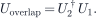
</p>

该结果是可继续组合、参数绑定或求逆的 Cqlib 线路，不自动测量，也不直接
返回一个重叠度标量。两个输入的量子比特按各自的插入位置对应，输出紧凑映射到
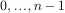，因此源量子比特标识无需相同。构造时保存两条输入的独立快照；后续
修改源线路不会改变组件，每次 `build_circuit()` 都返回新线路。

参数化输入的活动参数名会原样保留。两条线路中不得出现相同的活动参数名，
避免在组合时隐式共享训练参数。`insert_barrier=True` 只在 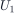 与 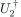
之间加入非语义 barrier，不改变线路矩阵。

```python
from cqlib import Circuit
from cqlib_algorithms.operators import UnitaryOverlap

first = Circuit(1)
first.h(0)

second = Circuit(1)
second.ry(0, 0.3)

overlap = UnitaryOverlap(first, second, insert_barrier=True).build_circuit()
inverse_overlap = overlap.inverse()
```

输入必须为等宽、可分解且可静态求逆的酉线路；允许 barrier，但拒绝测量、
重置、delay、经典数据和经典控制，包括嵌套线路中隐藏的这些操作。该组件实现
的是线路乘积 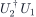，不是 Hilbert–Schmidt trace overlap。

## 采样态保真度

`ComputeUncomputeFidelity` 使用公共 `Sampler` 协议，估计两条 Cqlib 线路所制备
纯态之间的保真度。

## 数学定义

设

<p align="center">
  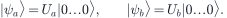
</p>

则纯态保真度为

<p align="center">
  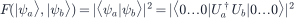
</p>

组件构建 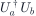 的 compute-uncompute 线路，并对全部量子比特采样。全零比特串
的频率即保真度估计值 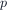。当 `shots > 1` 时，返回的估计方差为

<p align="center">
  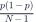
</p>

其中 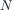 为 shots 数。

单次采样无法估计统计方差，因此 `variance` 为 `None`。

## 请求与结果

- `CircuitFidelityRequest`：保存两条制备线路、正整数 shots，以及两组独立的参数绑定；
- `CircuitFidelityResult`：返回 `[0, 1]` 内的保真度和可用时的估计方差；
- `ComputeUncomputeFidelity`：接收一个 `Sampler`，批量执行保真度请求。

两条线路必须具有相同的正宽度，并且是可完整绑定、可分解、可求逆的静态酉线路。
测量、重置、动态控制和不可求逆操作会在采样前被拒绝。参数绑定必须恰好覆盖线路当前
使用的全部符号，绑定值必须是有限实数。

两条线路按各自的量子比特插入位置对应，而不是按量子比特数值标识对应，因此支持
非连续且彼此不同的源量子比特标识。调用不会修改输入线路。

## 使用示例

```python
from cqlib import Circuit
from cqlib_algorithms.operators import (
    CircuitFidelityRequest,
    ComputeUncomputeFidelity,
    StatevectorSampler,
)

first = Circuit(1)
first.h(0)

same_state = Circuit(1)
same_state.h(0)
same_state.set_global_phase(0.4)

request = CircuitFidelityRequest(first, same_state, shots=256)
result = ComputeUncomputeFidelity(StatevectorSampler()).run([request])[0]

assert result.fidelity == 1.0
assert result.variance == 0.0
```

## 适用范围

该组件面向由线路制备的纯态，不计算密度矩阵的 Uhlmann 保真度、子系统保真度或混合态
SWAP 测试，也不执行测量误差缓解。数值态矢量与密度矩阵的直接保真度计算属于
Cqlib Core 的能力范围。

compute-uncompute 构造可用于量子特征映射核。

## 理论参考

[1] V. Havlíček et al., "Supervised learning with quantum-enhanced feature
spaces," Nature, 567, 209–212, 2019.
[DOI: 10.1038/s41586-019-0980-2](https://doi.org/10.1038/s41586-019-0980-2)。
