# 状态制备与数据编码

本页用于选择和组合状态制备组件。构造参数、返回值和异常以各类源码 docstring
为准；所有组件都实现 `StatePreparation`，每次构建返回独立线路。

## 组件一览

| 目标 | 推荐组件 |
| --- | --- |
| 固定计算基态、均匀叠加、GHZ、Dicke | `BasisStateInitialization`、`UniformSuperposition`、`GHZStatePreparation`、`DickeStatePreparation` |
| 任意纯态或独立单比特乘积态 | `ArbitraryStatePreparation`、`ProductStatePreparation` |
| 稠密或稀疏幅度数据 | `AmplitudeEncoding`、`SparseAmplitudeEncoding` |
| 角度、布尔或 Core Feature Map 数据 | `AngleEncoding`、`BasisEncoding`、`FeatureMapPreparation` |
| 图像数据 | `ImageAngleEncoding`、`ImageBasisEncoding`（`BRQI`） |
| 已有可逆线路 | `UserCircuitPreparation` |
| 电子结构参考态 | `HartreeFockStatePreparation`、`SlaterDeterminantStatePreparation`、`FermionicGaussianStatePreparation` |
| 晶格和振动参考态 | `LatticeReferenceStatePreparation`、`VSCFStatePreparation` |

`num_qubits` 和所有索引必须是真正的 Python `int`，不接受 `bool` 代替整数。
数值输入必须可转换为有限复数。配置或数值非法时抛出 `ValueError`，输入类型不匹配时
抛出 `TypeError`；有效配置进入 Core 后产生的 `CircuitError` 保留 Core 语义。

## 端序、归一化与相位

Cqlib 使用小端基态索引：量子比特 0 对应索引最低有效位。例如，
`BasisStateInitialization(3, 5)` 准备 ，其中输入位 `bits[0]` 对应量子比特 0。
幅度向量的第 `i` 项就是计算基态索引 `i` 的复幅度。

`ArbitraryStatePreparation` 不替调用方掩盖明显的归一化错误，只接受相对误差和绝对
误差均为 `1e-12` 范围内的单位向量，然后修正可接受的浮点舍入；
`AmplitudeEncoding` 和 `SparseAmplitudeEncoding` 则自动归一化非零数据。
实现只把精确的复数零视为零，不用阈值删除小幅度。

数值态综合保留相对相位和全局相位。验证线路输出时应比较
`Circuit.to_matrix()[:, 0]` 与目标复幅度向量；Core 的 Statevector 演化不包含线路的
`global_phase`，因此不能单独用于精确全局相位验收。

## Dicke 态

`DickeStatePreparation(n, k)` 制备 `n` 个量子比特上 Hamming weight 恰为 `k`
的均匀叠加态：

<p align="center">
  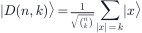
</p>

量子比特 0 仍是最低有效位，但目标态包含全部 weight-`k` 位串，因此不依赖某一种
位串书写方向。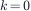 返回全零态，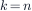 返回全一态；中间权重通过 Dicke
权重分布酉线路构造。组件不测量 Hamming weight，也不替调用方选择问题相关的 `k`。

## 稠密态综合

`ArbitraryStatePreparation` 与 `AmplitudeEncoding` 使用 Möttönen 的均匀受控旋转
方法：先以 RY 树综合幅度绝对值，再以 RZ 树和线路全局相位综合复相位。通常 UCR
通过循环 Gray code 和 Walsh-Hadamard 角变换降为单比特旋转与 CX；当极端动态范围
会使 Walsh 角变换丢失可表示的非零小角度时，使用互斥控制模式的多控旋转回退。
实现不构造稠密 `UnitaryGate`。

算法来源：M. Möttönen 等，
[Transformation of quantum states using uniformly controlled rotations](https://arxiv.org/abs/quant-ph/0407010)。

## 稀疏态综合

`SparseAmplitudeEncoding` 根据显式给出的非零基态索引及幅度制备稀疏量子态，并参考
Gleinig 与 Hoefler 的
[An Efficient Algorithm for Sparse Quantum State Preparation](https://spcl.inf.ethz.ch/Publications/.pdf/quantum_dac.pdf)
（[DOI 10.1109/DAC18074.2021.9586240](https://doi.org/10.1109/DAC18074.2021.9586240)）。
该组件适合支持集远小于完整希尔伯特空间的输入；它执行显式线路综合，不提供 QRAM
或数据加载加速。具体综合方法、输入约束和复杂度界见源码 docstring。

## Core 适配边界

`BasisEncoding`、`AngleEncoding` 和 `FeatureMapPreparation` 保存输入快照并直接委托
兼容版本的 Cqlib Core 构建线路，不复制 Core 已有线路逻辑。

`UserCircuitPreparation` 将源线路的量子比特按插入位置映射到连续 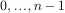，保留
活跃符号和线路全局相位，且 `prefix` 不重命名用户符号。它要求线路可由 Core 静态
求逆，因此拒绝测量、重置、动态控制等非幺正操作。当前 Core 也不能对三量子比特及
以上的矩阵型 `UnitaryGate` 求逆，即使矩阵本身是幺正的；该限制会在构造时明确暴露，
不能用稠密酉门绕过。

## 物理参考态

`HartreeFockStatePreparation` 将 `ElectronicOccupation` 交给同一费米映射器生成计算
基占据态。`SlaterDeterminantStatePreparation` 接收列正交的轨道系数矩阵，用相邻
Givens 旋转制备固定粒子数 Slater 行列式。`FermionicGaussianStatePreparation` 进一步
接受规范 Bogoliubov 变换，可制备粒子数不守恒但费米宇称确定的 Gaussian 态；纯
粒子数守恒输入自动复用 Slater 制备。

`LatticeReferenceStatePreparation` 校验计算基配置与 `LatticeSystem` 的模型、宽度和
守恒扇区一致。`VSCFStatePreparation` 在每个振动 mode 的 one-hot qubit 块中选择
恰好一个 modal，默认选择 modal 0。完整领域用法见[分子电子结构](../domains/electronic-structure.md)、
[晶格与自旋模型](../domains/lattice-models.md)和
[振动与有限 Modal 系统](../domains/vibrational-systems.md)。

## 图像编码

两个图像组件都接受 `(height, width)` 和通道优先的扁平行优先数据。若
，`ImageAngleEncoding` 将通道 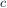 的第 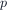 个标量放在
量子比特 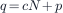，并按
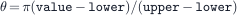 施加 `RY(theta)`。输入值和范围
必须有限，且由调用方在编码前完成所需的裁剪。每个标量使用一个量子比特和一个局部
旋转，形成直积态编码。

`ImageBasisEncoding`（精确别名 `BRQI`）实现固定 8 位单通道灰度 BRQI。对
、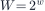，目标态为

<p align="center">
  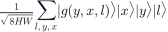
</p>

其中 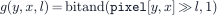， 为最低有效位平面。Cqlib 小端物理
布局固定为：量子比特 0 是值位，其后依次为 `w` 个列位、`h` 个行位和 3 个平面位，
各寄存器内部均最低有效位在前。对应基态索引为
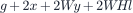。

线路先对全部地址与平面量子比特施加 H，再对每个值为 1 的 `(x,y,l)` 地址使用完整
开放/闭合控制写入值位，返回未测量的状态制备线路。只接受恰好一个通道，像素必须是真正的 Python
整数且位于 ；高和宽必须分别为 2 的非负整数次幂（含 1）。逻辑量子比特数为
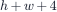；经典构造显式枚举 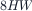 个像素位，线路规模和构造时间随输入图像的数据量
增长。

## 使用示例

```python
from cqlib_algorithms.operators.state_preparation import AmplitudeEncoding

preparation = AmplitudeEncoding([1.0, 1.0j, 0.0, 0.0])
preparation.validate()
circuit = preparation.build_circuit("data")

assert preparation.num_qubits() == 2
assert preparation.num_parameters() == 0
assert circuit.num_qubits == 2
```

```python
from cqlib_algorithms.operators.state_preparation import ImageAngleEncoding

image = ImageAngleEncoding((1, 2), [[0.0, 255.0]])
circuit = image.build_circuit("ignored")
assert image.num_qubits() == 2
```

```python
from cqlib_algorithms.operators.state_preparation import BRQI

image = BRQI((2, 2), [[0, 64, 128, 255]])
circuit = image.build_circuit("ignored")
assert image.num_qubits() == 6
assert image.num_parameters() == 0
```
