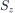

# 晶格与自旋模型

晶格链把带权拓扑、物理模型和守恒扇区组合成可求解系统。当前覆盖含自旋
Fermi–Hubbard、横场 Ising 和各向异性 Heisenberg 模型，并提供物理参考态、
守恒拟设、VQE 基态和局域观测量。

## 计算链

```text
Lattice / LineLattice / SquareLattice / HyperCubicLattice
→ FermiHubbardModel / IsingModel / HeisenbergModel
→ FermionicSector / SpinMagnetizationSector
→ LatticeSystem
→ reference configuration + sector-preserving ansatz
→ LatticeGroundState
→ occupations / magnetizations / correlations
```

`Lattice` 的边权属于物理模型：Fermi–Hubbard 接受复 hopping，反向边自动使用共轭；
自旋模型要求实耦合。Fermi–Hubbard 始终要求显式 `num_up`、`num_down` 扇区；只有在
Hamiltonian 守恒总  时，自旋模型才允许固定磁化扇区。

内置晶格使用简单无向图，同一节点对至多有一条边。因此长度为 2 的周期轴与开边界轴
具有相同连接关系，不额外表示两个方向对应的平行键；长度至少为 3 时才增加首尾回绕
边。构造长度为 2 的周期轴时会发出运行时警告，避免把这种简单图语义误认为两条平行
物理键。二值邻接矩阵记录声明的拓扑连接，所以保留零权边和显式自环；加权邻接矩阵才
记录实际物理权重。需要平行键或键重数的模型应使用能显式表达该结构的自定义组件，而
不能把它隐式折叠进当前 `Lattice`。

## 使用示例

```python
from cqlib_algorithms.extension.lattice import (
    BoundaryCondition,
    FermiHubbardModel,
    FermionicLatticeConfiguration,
    FermionicSector,
    LatticeSystem,
    LineLattice,
    SiteOccupation,
    TotalParticleNumber,
)
from cqlib_algorithms.operators import FermiHubbardAnsatz

lattice = LineLattice(
    4,
    edge_parameter=-1.0,
    onsite_parameter=0.2,
    boundary_condition=BoundaryCondition.PERIODIC,
)
model = FermiHubbardModel(
    lattice,
    onsite_interaction=(2.0, 2.0, 2.5, 2.5),
)
system = LatticeSystem(model, FermionicSector(4, num_up=2, num_down=2))
reference = FermionicLatticeConfiguration.neel(4)
ansatz = FermiHubbardAnsatz(system, reference, reps=2)

hamiltonian = model.qubit_hamiltonian()
particle_number = TotalParticleNumber(model).to_qubit_hamiltonian()
site_zero = SiteOccupation(model, 0).to_qubit_hamiltonian()
```

`LatticeGroundState` 接收 Estimator 和 Optimizer，并复用公共 VQE。默认路径根据模型
选择 `FermiHubbardAnsatz` 或 `SpinExchangeAnsatz`；自定义拟设必须自行保持预期的
物理子空间。结果对 Fermi–Hubbard 返回粒子数、格点占据和双占据，对自旋模型返回
总/局域磁化、边关联和相互作用能。

下面直接组合拟设、估计器和优化器，求解两格点单电子 hopping 问题：

```python
from cqlib_algorithms import LatticeGroundState
from cqlib_algorithms.extension.lattice import (
    FermiHubbardModel,
    FermionicLatticeConfiguration,
    FermionicSector,
    Lattice,
    LatticeSystem,
)
from cqlib_algorithms.operators import FermiHubbardAnsatz, StatevectorEstimator
from cqlib_algorithms.operators.optimizer import COBYLAOptimizer

system = LatticeSystem(
    FermiHubbardModel(
        Lattice.from_nodes_and_edges(
            2,
            ((0, 0, 0.3), (0, 1, -1.0), (1, 1, -0.3)),
        )
    ),
    FermionicSector(2, num_up=1, num_down=0),
)
ansatz = FermiHubbardAnsatz(system, FermionicLatticeConfiguration(2, (0,), ()))
result = LatticeGroundState(
    StatevectorEstimator(),
    COBYLAOptimizer(maxiter=100),
).run(system, ansatz=ansatz)
print(result.variational_energy)
print(result.measurements.total_particle_number.expectation)
```

能量应接近该模型的精确基态能量 `-sqrt(1.09)`（约 `-1.04403`），总粒子数约为 `1.0`；有限次经典优化的
误差需结合收敛状态判断。固定磁化的自旋问题可使用 `SpinExchangeAnsatz`。显式提供
拟设时，配置和层数由该组件管理；省略拟设时仍可用 `configuration`、`reps` 配置
默认路径。`compute()` 与 `run()` 使用相同的求解流程。

## 适用边界

- 内置拓扑覆盖通用、线形、矩形和超立方最近邻晶格；未提供三角、蜂窝和 Kagome
  便捷构造器。
- `SpinOp` 与 `SpinHalfMapper` 当前只形成自旋一半求解链；高自旋不映射到量子比特。
- 默认守恒拟设要求非平凡扇区的非零相互作用图连通；不连通系统应显式选择分量扇区
  或提供自定义拟设。
- 当前闭环面向基态，不包含晶格激发态、时间演化和有限温度算法。
